# GSM Data Dictionary

**Model:** GSM

**Generated:** 2026-09-24 5:03:27 PM

---

## egm_profile_group_status_type

### Columns

| Column | Data Type | Size | Null |
|--------|-----------|------|------|
| key_code | varchar | 54 | NOT NULL |

### Indexes

| Index Name |
|------------|
| egm_profile_group_status_type_pk |

---

## site_h

### Columns

| Column | Data Type | Size | Null |
|--------|-----------|------|------|
| site_type_key_code | varchar | 54 | NOT NULL |
| DELETED_FLAG | character | 1 | NOT NULL |
| AUDIT_DATETIME | timestamp | 8 | NOT NULL |
| version_number | integer | 4 | NOT NULL |
| ref_number | varchar | 14 | NOT NULL |
| DESCR | varchar | 104 | NOT NULL |
| REVISION_NUMBER | bigint | 8 | NOT NULL |
| id | integer | 4 | NOT NULL |
| domain_id | integer | 4 | NOT NULL |
| time_zone_type_key_code | varchar | 54 | NOT NULL |
| entity_status_type_key_code | varchar | 54 | NOT NULL |
| AUDIT_USER_ID | integer | 4 | NOT NULL |
| cross_valid_all_flag | character | 1 | NOT NULL |
| cross_valid_chain_flag | character | 1 | NOT NULL |
| tito_enabled_flag | character | 1 | NOT NULL |
| invoice_enabled_flag | character | 1 | NOT NULL |
| AUDIT Type | character | 1 | NOT NULL |
| activation_date | timestamp | 8 | NULL |
| deactivation_date | timestamp | 8 | NULL |
| cashout_header_use_gaming_site_name_flag | character | 1 | NOT NULL |
| cashout_header_use_gaming_site_address_flag | character | 1 | NOT NULL |
| entity_reason_type_key_code | varchar | 54 | NOT NULL |

### Indexes

| Index Name |
|------------|
| site_h_pk |

---

## site_entity_status_detail

### Columns

| Column | Data Type | Size | Null |
|--------|-----------|------|------|
| ID | integer | 4 | NOT NULL |
| AUDIT_DATETIME | timestamp | 8 | NOT NULL |
| AUDIT_USER_ID | integer | 4 | NOT NULL |
| VERSION_NUMBER | integer | 4 | NOT NULL |
| id | integer | 4 | NOT NULL |
| key_code | varchar | 54 | NOT NULL |

### Indexes

| Index Name |
|------------|
| site_entity_status_detail_pk |
| site_entity_status_detail_i1 |

---

## user_audit_log

### Columns

| Column | Data Type | Size | Null |
|--------|-----------|------|------|
| id | integer | 4 | NOT NULL |
| operation_type | varchar | 104 | NOT NULL |
| entity_type | varchar | 54 | NOT NULL |
| entity_id | integer | 4 | NOT NULL |
| entity_display_value | varchar | 259 | NOT NULL |
| anonymized_flag | character | 1 | NOT NULL |
| audit_user_id | integer | 4 | NOT NULL |
| AUDIT_DATETIME | timestamp | 8 | NOT NULL |
| operation_id | varchar | 54 | NULL |
| parent_operation_id | varchar | 54 | NULL |
| item_id | integer | 4 | NULL |
| item_type | varchar | 54 | NULL |
| item_display_value | varchar | 259 | NULL |

### Indexes

| Index Name |
|------------|
| user_audit_log_pk |

---

## user_audit_log_reference

### Columns

| Column | Data Type | Size | Null |
|--------|-----------|------|------|
| ID | integer | 4 | NOT NULL |
| attribute_name | character | 100 | NOT NULL |
| old_value | varchar | 1004 | NULL |
| new_value | varchar | 1004 | NULL |
| level | integer | 4 | NULL |
| id | integer | 4 | NOT NULL |
| AUDIT_DATETIME | timestamp | 8 | NOT NULL |
| AUDIT_USER_ID | integer | 4 | NOT NULL |

### Indexes

| Index Name |
|------------|
| user_audit_log_reference_pk |

---

## vendor_domain

### Columns

| Column | Data Type | Size | Null |
|--------|-----------|------|------|
| id | integer | 4 | NOT NULL |
| AUDIT_DATETIME | timestamp | 8 | NOT NULL |
| AUDIT_USER_ID | integer | 4 | NOT NULL |
| domain_id | integer | 4 | NOT NULL |
| deleted_flag | character | 1 | NOT NULL |
| id | integer | 4 | NOT NULL |

### Indexes

| Index Name |
|------------|
| vendor_domain_pk |
| vendor_domain_uk1 |

---

## vsc_config_domain

### Columns

| Column | Data Type | Size | Null |
|--------|-----------|------|------|
| id | integer | 4 | NOT NULL |
| AUDIT_DATETIME | timestamp | 8 | NOT NULL |
| AUDIT_USER_ID | integer | 4 | NOT NULL |
| domain_id | integer | 4 | NOT NULL |
| deleted_flag | character | 1 | NOT NULL |
| id | integer | 4 | NOT NULL |

### Indexes

| Index Name |
|------------|
| vsc_config_domain_pk |
| vsc_config_domain_uk1 |

---

## vsc_config_domain_h

### Columns

| Column | Data Type | Size | Null |
|--------|-----------|------|------|
| id | integer | 4 | NOT NULL |
| AUDIT_DATETIME | timestamp | 8 | NOT NULL |
| AUDIT_USER_ID | integer | 4 | NOT NULL |
| domain_id | integer | 4 | NOT NULL |
| deleted_flag | character | 1 | NOT NULL |
| vsc_config_id | integer | 4 | NOT NULL |
| audit_operation | character | 1 | NOT NULL |

### Indexes

| Index Name |
|------------|
| vsc_config_domain_h_pk |

---

## license_domain

### Columns

| Column | Data Type | Size | Null |
|--------|-----------|------|------|
| id | integer | 4 | NOT NULL |
| AUDIT_DATETIME | timestamp | 8 | NOT NULL |
| AUDIT_USER_ID | integer | 4 | NOT NULL |
| domain_id | integer | 4 | NOT NULL |
| deleted_flag | character | 1 | NOT NULL |
| id | integer | 4 | NOT NULL |

### Indexes

| Index Name |
|------------|
| license_domain_pk |
| license_domain_uk1 |

---

## license_domain_h

### Columns

| Column | Data Type | Size | Null |
|--------|-----------|------|------|
| id | integer | 4 | NOT NULL |
| AUDIT_DATETIME | timestamp | 8 | NOT NULL |
| AUDIT_USER_ID | integer | 4 | NOT NULL |
| domain_id | integer | 4 | NOT NULL |
| deleted_flag | character | 1 | NOT NULL |
| license_id | integer | 4 | NOT NULL |
| audit_operation | character | 1 | NOT NULL |

### Indexes

| Index Name |
|------------|
| license_domain_h_pk |

---

## contact_h

### Columns

| Column | Data Type | Size | Null |
|--------|-----------|------|------|
| id | integer | 4 | NOT NULL |
| phone_number_backup | varchar | 28 | NULL |
| phone_number | varchar | 28 | NULL |
| AUDIT_USER_ID | integer | 4 | NOT NULL |
| last_name | varchar | 54 | NOT NULL |
| version_number | integer | 4 | NOT NULL |
| middle_name | varchar | 54 | NULL |
| fax_number | varchar | 28 | NULL |
| first_name | varchar | 54 | NOT NULL |
| email_addr | varchar | 104 | NULL |
| AUDIT_DATETIME | timestamp | 8 | NOT NULL |
| audit_operation | character | 1 | NOT NULL |

### Indexes

| Index Name |
|------------|
| contact_h_pk |

---

## model_domain

### Columns

| Column | Data Type | Size | Null |
|--------|-----------|------|------|
| id | integer | 4 | NOT NULL |
| AUDIT_DATETIME | timestamp | 8 | NOT NULL |
| AUDIT_USER_ID | integer | 4 | NOT NULL |
| domain_id | integer | 4 | NOT NULL |
| deleted_flag | character | 1 | NOT NULL |
| id | integer | 4 | NOT NULL |

### Indexes

| Index Name |
|------------|
| model_domain_pk |
| model_domain_uk1 |

---

## model_domain_h

### Columns

| Column | Data Type | Size | Null |
|--------|-----------|------|------|
| id | integer | 4 | NOT NULL |
| AUDIT_DATETIME | timestamp | 8 | NOT NULL |
| AUDIT_USER_ID | integer | 4 | NOT NULL |
| domain_id | integer | 4 | NOT NULL |
| deleted_flag | character | 1 | NOT NULL |
| model_id | integer | 4 | NOT NULL |
| audit_operation | character | 1 | NOT NULL |

### Indexes

| Index Name |
|------------|
| model_domain_h_pk |

---

## trait_domain

### Columns

| Column | Data Type | Size | Null |
|--------|-----------|------|------|
| id | integer | 4 | NOT NULL |
| AUDIT_DATETIME | timestamp | 8 | NOT NULL |
| AUDIT_USER_ID | integer | 4 | NOT NULL |
| domain_id | integer | 4 | NOT NULL |
| deleted_flag | character | 1 | NOT NULL |
| id | integer | 4 | NOT NULL |

### Indexes

| Index Name |
|------------|
| trait_domain_pk |
| trait_domain_uk1 |

---

## trait_domain_h

### Columns

| Column | Data Type | Size | Null |
|--------|-----------|------|------|
| id | integer | 4 | NOT NULL |
| AUDIT_DATETIME | timestamp | 8 | NOT NULL |
| AUDIT_USER_ID | integer | 4 | NOT NULL |
| domain_id | integer | 4 | NOT NULL |
| deleted_flag | character | 1 | NOT NULL |
| trait_id | integer | 4 | NOT NULL |
| audit_operation | character | 1 | NOT NULL |

### Indexes

| Index Name |
|------------|
| trait_domain_h_pk |

---

## addr_h

### Columns

| Column | Data Type | Size | Null |
|--------|-----------|------|------|
| zip | varchar | 29 | NOT NULL |
| line2 | varchar | 104 | NULL |
| version_number | integer | 4 | NOT NULL |
| po_box | varchar | 14 | NULL |
| city | varchar | 34 | NOT NULL |
| id | integer | 4 | NOT NULL |
| AUDIT_USER_ID | integer | 4 | NOT NULL |
| line1 | varchar | 104 | NOT NULL |
| state | varchar | 29 | NOT NULL |
| AUDIT_DATETIME | timestamp | 8 | NOT NULL |
| audit_operation | character | 1 | NOT NULL |

### Indexes

| Index Name |
|------------|
| addr_h_pk |

---

## contact_addr_h

### Columns

| Column | Data Type | Size | Null |
|--------|-----------|------|------|
| addr_id | integer | 4 | NOT NULL |
| contact_id | integer | 4 | NOT NULL |
| id | integer | 4 | NOT NULL |
| AUDIT_DATETIME | timestamp | 8 | NOT NULL |
| addr_type_key_code | varchar | 54 | NOT NULL |
| AUDIT_USER_ID | integer | 4 | NOT NULL |
| audit_operation | character | 1 | NOT NULL |

### Indexes

| Index Name |
|------------|
| contact_addr_h_pk |

---

## site_contact_h

### Columns

| Column | Data Type | Size | Null |
|--------|-----------|------|------|
| id | integer | 4 | NOT NULL |
| AUDIT_DATETIME | timestamp | 8 | NOT NULL |
| contact_id | integer | 4 | NOT NULL |
| contact_type_key_code | varchar | 54 | NOT NULL |
| site_id | integer | 4 | NOT NULL |
| primary_flag | character | 1 | NOT NULL |
| AUDIT_USER_ID | integer | 4 | NOT NULL |
| audit_operation | character | 1 | NOT NULL |

### Indexes

| Index Name |
|------------|
| site_contact_h_pk |

---

## profile_group_domain_h

### Columns

| Column | Data Type | Size | Null |
|--------|-----------|------|------|
| id | integer | 4 | NOT NULL |
| AUDIT_DATETIME | timestamp | 8 | NOT NULL |
| domain_id | integer | 4 | NOT NULL |
| AUDIT_USER_ID | integer | 4 | NOT NULL |
| profile_group_id | integer | 4 | NULL |
| audit_operation | character | 1 | NOT NULL |

### Indexes

| Index Name |
|------------|
| profile_group_domain_h_pk |

---

## gaming_hours_profile_domain_h

### Columns

| Column | Data Type | Size | Null |
|--------|-----------|------|------|
| id | integer | 4 | NOT NULL |
| gaming_hours_profile_id | integer | 4 | NOT NULL |
| domain_id | integer | 4 | NOT NULL |
| AUDIT_DATETIME | timestamp | 8 | NOT NULL |
| AUDIT_USER_ID | integer | 4 | NOT NULL |
| audit_operation | character | 1 | NOT NULL |

### Indexes

| Index Name |
|------------|
| gaming_hours_profile_domain_h_pk |

---

## egm_h

### Columns

| Column | Data Type | Size | Null |
|--------|-----------|------|------|
| DESCR | varchar | 104 | NOT NULL |
| ip_addr | character | 15 | NULL |
| VERSION_NUMBER | integer | 4 | NOT NULL |
| id | integer | 4 | NOT NULL |
| entity_status_type_key_code | varchar | 54 | NOT NULL |
| REVISION_NUMBER | bigint | 8 | NOT NULL |
| position_number | integer | 4 | NOT NULL |
| egm_protocol_type_key_code | varchar | 54 | NOT NULL |
| comm_idn | varchar | 54 | NOT NULL |
| install_date | timestamp | 8 | NOT NULL |
| purchase_amount | decimal | 16 | NULL |
| asset_ref_number | varchar | 36 | NOT NULL |
| deinstall_date | timestamp | 8 | NULL |
| model_id | integer | 4 | NOT NULL |
| serial_number | varchar | 36 | NOT NULL |
| AUDIT_DATETIME | timestamp | 8 | NOT NULL |
| DELETED_FLAG | character | 1 | NOT NULL |
| AUDIT_USER_ID | integer | 4 | NOT NULL |
| purchase_date | timestamp | 8 | NULL |
| vsc_id | integer | 4 | NOT NULL |
| invoice_enabled_flag | character | 1 | NOT NULL |
| domain_id | integer | 4 | NOT NULL |
| egm_gaming_hours_profile_id | integer | 4 | NULL |
| audit_operation | character | 1 | NOT NULL |

### Indexes

| Index Name |
|------------|
| egm_h_pk |

---

## vendor_h

### Columns

| Column | Data Type | Size | Null |
|--------|-----------|------|------|
| id | integer | 4 | NOT NULL |
| version_number | integer | 4 | NOT NULL |
| DESCR | varchar | 104 | NOT NULL |
| AUDIT_DATETIME | timestamp | 8 | NOT NULL |
| AUDIT_USER_ID | integer | 4 | NOT NULL |
| owner_domain_id | integer | 4 | NULL |
| domain_access_restricted_flag | character | 1 | NOT NULL |
| audit_operation | character | 1 | NOT NULL |
| DELETED_FLAG | character | 1 | NOT NULL |
| entity_type_key_code | varchar | 54 | NOT NULL |
| manufacturer_code | varchar | 7 | NULL |

### Indexes

| Index Name |
|------------|
| vendor_h_pk |

---

## model_h

### Columns

| Column | Data Type | Size | Null |
|--------|-----------|------|------|
| DESCR | varchar | 104 | NOT NULL |
| version_number | integer | 4 | NOT NULL |
| vendor_id | integer | 4 | NOT NULL |
| AUDIT_DATETIME | timestamp | 8 | NOT NULL |
| AUDIT_USER_ID | integer | 4 | NOT NULL |
| id | integer | 4 | NOT NULL |
| owner_domain_id | integer | 4 | NOT NULL |
| domain_access_restricted_flag | character | 1 | NOT NULL |
| audit_operation | character | 1 | NOT NULL |
| DELETED_FLAG | character | 1 | NOT NULL |

### Indexes

| Index Name |
|------------|
| model_h_pk |

---

## vsc_h

### Columns

| Column | Data Type | Size | Null |
|--------|-----------|------|------|
| entity_status_type_key_code | varchar | 54 | NOT NULL |
| id | integer | 4 | NOT NULL |
| vsc_config_id | integer | 4 | NOT NULL |
| asset_ref_number | varchar | 36 | NULL |
| serial_number | varchar | 36 | NOT NULL |
| comm_idn | varchar | 54 | NOT NULL |
| comm_active_flag | character | 1 | NOT NULL |
| install_date | timestamp | 8 | NULL |
| VERSION_NUMBER | integer | 4 | NOT NULL |
| site_id | integer | 4 | NOT NULL |
| purchase_date | timestamp | 8 | NULL |
| REVISION_NUMBER | bigint | 8 | NOT NULL |
| AUDIT_USER_ID | integer | 4 | NOT NULL |
| AUDIT_DATETIME | timestamp | 8 | NOT NULL |
| deleted_flag | character | 1 | NOT NULL |
| ip_addr | varchar | 19 | NULL |
| DESCR | varchar | 104 | NOT NULL |
| deinstall_date | timestamp | 8 | NULL |
| domain_id | integer | 4 | NOT NULL |
| audit_operation | character | 1 | NOT NULL |

### Indexes

| Index Name |
|------------|
| vsc_h_pk |

---

## vendor_domain_h

### Columns

| Column | Data Type | Size | Null |
|--------|-----------|------|------|
| id | integer | 4 | NOT NULL |
| AUDIT_DATETIME | timestamp | 8 | NOT NULL |
| AUDIT_USER_ID | integer | 4 | NOT NULL |
| domain_id | integer | 4 | NOT NULL |
| deleted_flag | character | 1 | NOT NULL |
| vendor_id | integer | 4 | NOT NULL |
| audit_operation | character | 1 | NOT NULL |

### Indexes

| Index Name |
|------------|
| vendor_domain_h_pk |

---

## license_h

### Columns

| Column | Data Type | Size | Null |
|--------|-----------|------|------|
| issue_date | timestamp | 8 | NULL |
| documentation_ref | varchar | 254 | NULL |
| status_change_comment | varchar | 254 | NULL |
| license_status_type_key_code | varchar | 54 | NOT NULL |
| deleted_flag | character | 1 | NOT NULL |
| expire_date | timestamp | 8 | NULL |
| comment | varchar | 254 | NULL |
| license_type_key_code | varchar | 54 | NOT NULL |
| max_egms | integer | 4 | NOT NULL |
| license_ref_number | varchar | 24 | NOT NULL |
| version_number | integer | 4 | NOT NULL |
| AUDIT_DATETIME | timestamp | 8 | NOT NULL |
| id | integer | 4 | NOT NULL |
| AUDIT_USER_ID | integer | 4 | NOT NULL |
| owner_domain_id | integer | 4 | NOT NULL |
| domain_access_restricted_flag | character | 1 | NOT NULL |
| audit_operation | character | 1 | NOT NULL |

### Indexes

| Index Name |
|------------|
| license_h_pk |

---

## site_license_h

### Columns

| Column | Data Type | Size | Null |
|--------|-----------|------|------|
| license_id | integer | 4 | NOT NULL |
| site_id | integer | 4 | NOT NULL |
| id | integer | 4 | NOT NULL |
| AUDIT_USER_ID | integer | 4 | NOT NULL |
| AUDIT_DATETIME | timestamp | 8 | NOT NULL |
| audit_operation | character | 1 | NOT NULL |

### Indexes

| Index Name |
|------------|
| site_license_h_pk |

---

## cabinet_dvc_cfg_profile_h

### Columns

| Column | Data Type | Size | Null |
|--------|-----------|------|------|
| large_win_limit | decimal | 16 | NOT NULL |
| idle_time_period | integer | 4 | NOT NULL |
| report_denom_id | integer | 4 | NOT NULL |
| id | integer | 4 | NOT NULL |
| locale_type_key_code | varchar | 54 | NOT NULL |
| sync_meter_to_host_flag | character | 1 | NOT NULL |
| currency_type_key_code | varchar | 54 | NOT NULL |
| reel_stop_flag | character | 1 | NOT NULL |
| time_zone_offset | varchar | 10 | NOT NULL |
| no_response_timer | integer | 4 | NULL |
| REQUIRED_FOR_PLAY_FLAG | character | 1 | NOT NULL |
| accept_non_cash_amount_type_key_code | varchar | 54 | NOT NULL |
| auto_cashout_behaviour_type_key_code | varchar | 54 | NOT NULL |
| outcome_tax_percent | integer | 4 | NOT NULL |
| auto_cashout_amount | decimal | 16 | NULL |
| auto_cashout_limit | decimal | 16 | NULL |
| outcome_tax_threshold | integer | 4 | NOT NULL |
| reel_duration | integer | 4 | NOT NULL |
| min_log_entries | integer | 4 | NULL |
| max_credit_meter | decimal | 16 | NOT NULL |
| idle_text | varchar | 504 | NULL |
| money_input_disable_limit | decimal | 16 | NULL |
| audit_operation | character | 1 | NOT NULL |
| AUDIT_DATETIME | timestamp | 8 | NOT NULL |
| AUDIT_USER_ID | integer | 4 | NOT NULL |

### Indexes

| Index Name |
|------------|
| cabinet_dvc_cfg_profile_h_pk |

---

## printer_dvc_cfg_profile_h

### Columns

| Column | Data Type | Size | Null |
|--------|-----------|------|------|
| REQUIRED_FOR_PLAY_FLAG | character | 1 | NOT NULL |
| id | integer | 4 | NOT NULL |
| audit_operation | character | 1 | NOT NULL |
| AUDIT_DATETIME | timestamp | 8 | NOT NULL |
| AUDIT_USER_ID | integer | 4 | NOT NULL |

### Indexes

| Index Name |
|------------|
| printer_dvc_cfg_profile_h_pk |

---

## coin_acceptor_dvc_cfg_profile_h

### Columns

| Column | Data Type | Size | Null |
|--------|-----------|------|------|
| id | integer | 4 | NOT NULL |
| time_to_live_timer | integer | 4 | NULL |
| no_response_timer | integer | 4 | NULL |
| host_acknowledge_coin_flag | character | 1 | NOT NULL |
| REQUIRED_FOR_PLAY_FLAG | character | 1 | NOT NULL |
| audit_operation | character | 1 | NOT NULL |
| AUDIT_DATETIME | timestamp | 8 | NOT NULL |
| AUDIT_USER_ID | integer | 4 | NOT NULL |

### Indexes

| Index Name |
|------------|
| coin_acceptor_dvc_cfg_profile_h_pk |

---

## note_acceptor_dvc_cfg_profile_h

### Columns

| Column | Data Type | Size | Null |
|--------|-----------|------|------|
| voucher_enabled_flag | character | 1 | NOT NULL |
| id | integer | 4 | NOT NULL |
| host_authorize_notes_flag | character | 1 | NOT NULL |
| REQUIRED_FOR_PLAY_FLAG | character | 1 | NOT NULL |
| time_to_live_timer | integer | 4 | NULL |
| no_response_timer | integer | 4 | NULL |
| note_enabled_flag | character | 1 | NOT NULL |
| audit_operation | character | 1 | NOT NULL |
| AUDIT_DATETIME | timestamp | 8 | NOT NULL |
| AUDIT_USER_ID | integer | 4 | NOT NULL |

### Indexes

| Index Name |
|------------|
| note_acceptor_dvc_cfg_profile_h_pk |

---

## voucher_dvc_cfg_profile_h

### Columns

| Column | Data Type | Size | Null |
|--------|-----------|------|------|
| validation_id_list_refresh_timer | bigint | 8 | NULL |
| cash_promo_expiration_period | integer | 4 | NOT NULL |
| min_number_validation_ids | integer | 4 | NULL |
| validation_id_list_life_timer | bigint | 8 | NULL |
| print_offline_flag | character | 1 | NOT NULL |
| id | integer | 4 | NOT NULL |
| max_number_validation_ids | integer | 4 | NULL |
| time_to_live_timer | integer | 4 | NULL |
| REQUIRED_FOR_PLAY_FLAG | character | 1 | NOT NULL |
| audit_operation | character | 1 | NOT NULL |
| AUDIT_DATETIME | timestamp | 8 | NOT NULL |
| AUDIT_USER_ID | integer | 4 | NOT NULL |

### Indexes

| Index Name |
|------------|
| voucher_dvc_cfg_profile_h_pk |

---

## event_handler_dvc_cfg_profile_h

### Columns

| Column | Data Type | Size | Null |
|--------|-----------|------|------|
| id | integer | 4 | NOT NULL |
| time_to_live_timer | integer | 4 | NULL |
| min_log_entries | integer | 4 | NULL |
| audit_operation | character | 1 | NOT NULL |
| AUDIT_DATETIME | timestamp | 8 | NOT NULL |
| AUDIT_USER_ID | integer | 4 | NOT NULL |

### Indexes

| Index Name |
|------------|
| event_handler_dvc_cfg_profile_h_pk |

---

## note_acceptor_dvc_cfg_profile_note_h

### Columns

| Column | Data Type | Size | Null |
|--------|-----------|------|------|
| note_enabled_flag | character | 1 | NOT NULL |
| AUDIT_DATETIME | timestamp | 8 | NOT NULL |
| note_acceptor_dvc_cfg_profile_id | integer | 4 | NOT NULL |
| AUDIT_USER_ID | integer | 4 | NOT NULL |
| id | integer | 4 | NOT NULL |
| VERSION_NUMBER | integer | 4 | NOT NULL |
| note_acceptor_note_id | integer | 4 | NOT NULL |
| audit_operation | character | 1 | NOT NULL |

### Indexes

| Index Name |
|------------|
| note_acceptor_dvc_cfg_profile_note_h_pk |

---

## note_acceptor_note_h

### Columns

| Column | Data Type | Size | Null |
|--------|-----------|------|------|
| DESCR | varchar | 104 | NOT NULL |
| number_of_base_units | decimal | 16 | NOT NULL |
| AUDIT_USER_ID | integer | 4 | NOT NULL |
| AUDIT_DATETIME | timestamp | 8 | NOT NULL |
| id | integer | 4 | NOT NULL |
| currency_type_key_code | varchar | 54 | NOT NULL |
| audit_operation | character | 1 | NOT NULL |

### Indexes

| Index Name |
|------------|
| note_acceptor_note_h_pk |

---

## cfg_profile_h

### Columns

| Column | Data Type | Size | Null |
|--------|-----------|------|------|
| cfg_profile_type_key_code | varchar | 54 | NOT NULL |
| id | integer | 4 | NOT NULL |
| AUDIT_USER_ID | integer | 4 | NOT NULL |
| AUDIT_DATETIME | timestamp | 8 | NOT NULL |
| DESCR | varchar | 104 | NOT NULL |
| version_number | integer | 4 | NOT NULL |
| revision_number | bigint | 8 | NOT NULL |
| allow_update_cfg_profile_flag | character | 1 | NOT NULL |
| audit_operation | character | 1 | NOT NULL |

### Indexes

| Index Name |
|------------|
| cfg_profile_h_pk |

---

## profile_group_h

### Columns

| Column | Data Type | Size | Null |
|--------|-----------|------|------|
| profile_group_type_key_code | varchar | 54 | NOT NULL |
| AUDIT_DATETIME | timestamp | 8 | NOT NULL |
| id | integer | 4 | NOT NULL |
| descr | varchar | 104 | NOT NULL |
| version_number | integer | 4 | NOT NULL |
| AUDIT_USER_ID | integer | 4 | NOT NULL |
| audit_operation | character | 1 | NOT NULL |
| domain_access_restricted_flag | character | 1 | NOT NULL |
| owner_domain_id | integer | 4 | NULL |

### Indexes

| Index Name |
|------------|
| profile_group_h_pk |

---

## profile_group_cfg_profile_h

### Columns

| Column | Data Type | Size | Null |
|--------|-----------|------|------|
| AUDIT_DATETIME | timestamp | 8 | NOT NULL |
| cfg_profile_id | integer | 4 | NOT NULL |
| profile_group_id | integer | 4 | NOT NULL |
| id | integer | 4 | NOT NULL |
| AUDIT_USER_ID | integer | 4 | NOT NULL |
| audit_operation | character | 1 | NOT NULL |

### Indexes

| Index Name |
|------------|
| profile_group_cfg_profile_h_pk |

---

## egm_profile_group_h

### Columns

| Column | Data Type | Size | Null |
|--------|-----------|------|------|
| egm_id | integer | 4 | NOT NULL |
| id | integer | 4 | NOT NULL |
| profile_group_id | integer | 4 | NOT NULL |
| AUDIT_DATETIME | timestamp | 8 | NOT NULL |
| AUDIT_USER_ID | integer | 4 | NOT NULL |
| egm_profile_group_status_typ_key_code | varchar | 54 | NOT NULL |
| configuration_start_datetime | timestamp | 8 | NULL |
| configuration_complete_datetime | timestamp | 8 | NULL |
| audit_operation | character | 1 | NOT NULL |

### Indexes

| Index Name |
|------------|
| egm_profile_group_h_pk |

---

## sas_dvc_cfg_profile_h

### Columns

| Column | Data Type | Size | Null |
|--------|-----------|------|------|
| id | integer | 4 | NOT NULL |
| egm_protocol_revision_type_key_code | varchar | 54 | NOT NULL |
| AUDIT_DATETIME | timestamp | 8 | NOT NULL |
| AUDIT_USER_ID | integer | 4 | NOT NULL |
| audit_operation | character | 1 | NOT NULL |
| protocol_version | integer | 4 | NULL |

### Indexes

| Index Name |
|------------|
| sas_dvc_cfg_profile_h_pk |

---

## g2s_host_config_profile_h

### Columns

| Column | Data Type | Size | Null |
|--------|-----------|------|------|
| VERSION_NUMBER | integer | 4 | NOT NULL |
| id | integer | 4 | NOT NULL |
| g2s_host_type_key_code | varchar | 54 | NOT NULL |
| can_modify_remote_flag | character | 1 | NOT NULL |
| REQUIRED_FOR_PLAY_FLAG | character | 1 | NOT NULL |
| can_modify_local_flag | character | 1 | NOT NULL |
| authorized_host_flag | character | 1 | NOT NULL |
| display_communication_fault_flag | character | 1 | NOT NULL |
| allow_multicast_flag | character | 1 | NOT NULL |
| no_response_timer | integer | 4 | NOT NULL |
| time_to_live_timer | integer | 4 | NOT NULL |
| AUDIT_USER_ID | integer | 4 | NOT NULL |
| AUDIT_DATETIME | timestamp | 8 | NOT NULL |
| audit_operation | character | 1 | NOT NULL |

### Indexes

| Index Name |
|------------|
| g2s_host_config_profile_h_pk |

---

## license_type_site_type_h

### Columns

| Column | Data Type | Size | Null |
|--------|-----------|------|------|
| id | integer | 4 | NOT NULL |
| license_type_key_code | varchar | 54 | NOT NULL |
| site_type_key_code | varchar | 54 | NOT NULL |
| AUDIT_DATETIME | timestamp | 8 | NOT NULL |
| AUDIT_USER_ID | integer | 4 | NOT NULL |
| audit_operation | character | 1 | NOT NULL |

### Indexes

| Index Name |
|------------|
| license_type_site_type_h_pk |

---

## system_gaming_hours_override_h

### Columns

| Column | Data Type | Size | Null |
|--------|-----------|------|------|
| id | integer | 4 | NOT NULL |
| end_datetime | timestamp | 8 | NOT NULL |
| DESCR | varchar | 104 | NOT NULL |
| gaming_hours_profile_id | integer | 4 | NOT NULL |
| start_datetime | timestamp | 8 | NOT NULL |
| AUDIT_USER_ID | integer | 4 | NOT NULL |
| AUDIT_DATETIME | timestamp | 8 | NOT NULL |
| audit_operation | character | 1 | NOT NULL |

### Indexes

| Index Name |
|------------|
| system_gaming_hours_override_h_pk |

---

## gaming_hours_profile_h

### Columns

| Column | Data Type | Size | Null |
|--------|-----------|------|------|
| AUDIT_USER_ID | integer | 4 | NOT NULL |
| AUDIT_DATETIME | timestamp | 8 | NOT NULL |
| VERSION_NUMBER | integer | 4 | NOT NULL |
| id | integer | 4 | NOT NULL |
| DESCR | varchar | 104 | NOT NULL |
| audit_operation | character | 1 | NOT NULL |
| owner_domain_id | integer | 4 | NOT NULL |
| domain_access_restricted_flag | character | 1 | NOT NULL |
| external_id | varchar | 20 | NULL |

### Indexes

| Index Name |
|------------|
| gaming_hours_profile_h_pk |

---

## egm_gaming_hours_override_h

### Columns

| Column | Data Type | Size | Null |
|--------|-----------|------|------|
| AUDIT_DATETIME | timestamp | 8 | NOT NULL |
| AUDIT_USER_ID | integer | 4 | NOT NULL |
| technical_override_flag | character | 1 | NOT NULL |
| id | integer | 4 | NOT NULL |
| egm_gaming_hours_profile_id | integer | 4 | NOT NULL |
| start_datetime | timestamp | 8 | NOT NULL |
| end_datetime | timestamp | 8 | NOT NULL |
| close_all_day_flag | character | 1 | NOT NULL |
| audit_operation | character | 1 | NOT NULL |

### Indexes

| Index Name |
|------------|
| egm_gaming_hours_override_h_pk |

---

## system_gaming_hours_h

### Columns

| Column | Data Type | Size | Null |
|--------|-----------|------|------|
| weekday_type_key_code | varchar | 54 | NOT NULL |
| gaming_hours_profile_id | integer | 4 | NOT NULL |
| start_time | timestamp | 8 | NOT NULL |
| AUDIT_DATETIME | timestamp | 8 | NOT NULL |
| end_time | timestamp | 8 | NOT NULL |
| id | integer | 4 | NOT NULL |
| AUDIT_USER_ID | integer | 4 | NOT NULL |
| audit_operation | character | 1 | NOT NULL |

### Indexes

| Index Name |
|------------|
| system_gaming_hours_h_pk |

---

## egm_gaming_hours_profile_h

### Columns

| Column | Data Type | Size | Null |
|--------|-----------|------|------|
| VERSION_NUMBER | integer | 4 | NOT NULL |
| site_id | integer | 4 | NOT NULL |
| gaming_hours_profile_id | integer | 4 | NULL |
| id | integer | 4 | NOT NULL |
| descr | varchar | 104 | NOT NULL |
| AUDIT_DATETIME | timestamp | 8 | NOT NULL |
| AUDIT_USER_ID | integer | 4 | NOT NULL |
| audit_operation | character | 1 | NOT NULL |

### Indexes

| Index Name |
|------------|
| egm_gaming_hours_profile_h_pk |

---

## egm_gaming_hours_h

### Columns

| Column | Data Type | Size | Null |
|--------|-----------|------|------|
| id | integer | 4 | NOT NULL |
| egm_gaming_hours_profile_id | integer | 4 | NOT NULL |
| weekday_type_key_code | varchar | 54 | NOT NULL |
| start_time | timestamp | 8 | NOT NULL |
| end_time | timestamp | 8 | NOT NULL |
| AUDIT_DATETIME | timestamp | 8 | NOT NULL |
| AUDIT_USER_ID | integer | 4 | NOT NULL |
| audit_operation | character | 1 | NOT NULL |

### Indexes

| Index Name |
|------------|
| egm_gaming_hours_h_pk |

---

## license_gaming_hours_override_h

### Columns

| Column | Data Type | Size | Null |
|--------|-----------|------|------|
| AUDIT_USER_ID | integer | 4 | NOT NULL |
| id | integer | 4 | NOT NULL |
| zip | varchar | 14 | NOT NULL |
| DESCR | varchar | 104 | NOT NULL |
| end_datetime | timestamp | 8 | NOT NULL |
| license_id | integer | 4 | NOT NULL |
| start_datetime | timestamp | 8 | NOT NULL |
| AUDIT_DATETIME | timestamp | 8 | NOT NULL |
| audit_operation | character | 1 | NOT NULL |

### Indexes

| Index Name |
|------------|
| license_gaming_hours_override_h_pk |

---

## license_gaming_hours_h

### Columns

| Column | Data Type | Size | Null |
|--------|-----------|------|------|
| id | integer | 4 | NOT NULL |
| end_time | timestamp | 8 | NOT NULL |
| weekday_type_key_code | varchar | 54 | NOT NULL |
| license_id | integer | 4 | NOT NULL |
| VERSION_NUMBER | integer | 4 | NOT NULL |
| AUDIT_DATETIME | timestamp | 8 | NOT NULL |
| AUDIT_USER_ID | integer | 4 | NOT NULL |
| start_time | timestamp | 8 | NOT NULL |
| audit_operation | character | 1 | NOT NULL |

### Indexes

| Index Name |
|------------|
| license_gaming_hours_h_pk |

---

## site_addr_h

### Columns

| Column | Data Type | Size | Null |
|--------|-----------|------|------|
| site_id | integer | 4 | NOT NULL |
| id | integer | 4 | NOT NULL |
| AUDIT_DATETIME | timestamp | 8 | NOT NULL |
| AUDIT_USER_ID | integer | 4 | NOT NULL |
| addr_type_key_code | varchar | 54 | NOT NULL |
| addr_id | integer | 4 | NOT NULL |
| audit_operation | character | 1 | NOT NULL |

### Indexes

| Index Name |
|------------|
| site_addr_h_pk |

---

## site_entity_status_detail_h

### Columns

| Column | Data Type | Size | Null |
|--------|-----------|------|------|
| ID | integer | 4 | NOT NULL |
| entity_status_type_key_code | varchar | 54 | NOT NULL |
| AUDIT_DATETIME | timestamp | 8 | NOT NULL |
| AUDIT_USER_ID | integer | 4 | NOT NULL |
| VERSION_NUMBER | integer | 4 | NOT NULL |
| site_id | integer | 4 | NOT NULL |
| audit_operation | character | 1 | NOT NULL |

### Indexes

| Index Name |
|------------|
| site_entity_status_detail_h_pk |

---

## user_news_message_h

### Columns

| Column | Data Type | Size | Null |
|--------|-----------|------|------|
| id | integer | 4 | NOT NULL |
| version_number | integer | 4 | NOT NULL |
| message | json | -2 | NOT NULL |
| all_sites_flag | character | 1 | NOT NULL |
| AUDIT_USER_ID | integer | 4 | NOT NULL |
| print_flag | character | 1 | NOT NULL |
| acknowledge_flag | character | 1 | NOT NULL |
| end_datetime | timestamp | 8 | NOT NULL |
| AUDIT_DATETIME | timestamp | 8 | NOT NULL |
| start_datetime | timestamp | 8 | NOT NULL |
| priority_flag | character | 1 | NOT NULL |
| audit_operation | character | 1 | NOT NULL |
| owner_domain_id | integer | 4 | NOT NULL |
| domain_access_restricted_flag | character | 1 | NOT NULL |

### Indexes

| Index Name |
|------------|
| user_news_message_h_pk |

---

## user_news_message_site_h

### Columns

| Column | Data Type | Size | Null |
|--------|-----------|------|------|
| AUDIT_USER_ID | integer | 4 | NOT NULL |
| AUDIT_DATETIME | timestamp | 8 | NOT NULL |
| user_news_message_id | integer | 4 | NOT NULL |
| site_id | integer | 4 | NOT NULL |
| id | integer | 4 | NOT NULL |
| audit_operation | character | 1 | NOT NULL |

### Indexes

| Index Name |
|------------|
| user_news_message_site_h_pk |

---

## system_parameter_h

### Columns

| Column | Data Type | Size | Null |
|--------|-----------|------|------|
| VERSION_NUMBER | integer | 4 | NOT NULL |
| id | integer | 4 | NOT NULL |
| AUDIT_USER_ID | integer | 4 | NOT NULL |
| AUDIT_DATETIME | timestamp | 8 | NOT NULL |
| entity_type_key_code | varchar | 54 | NOT NULL |
| DESCR | varchar | 104 | NOT NULL |
| gui_editable_flag | character | 1 | NOT NULL |
| numeric_parameter_flag | character | 1 | NOT NULL |
| default_value | varchar | 34 | NOT NULL |
| parameter_key | character | 50 | NOT NULL |
| audit_operation | character | 1 | NOT NULL |

### Indexes

| Index Name |
|------------|
| system_parameter_h_pk |

---

## trait_type_h

### Columns

| Column | Data Type | Size | Null |
|--------|-----------|------|------|
| trait_generation_type_key_code | varchar | 54 | NULL |
| AUDIT_DATETIME | timestamp | 8 | NOT NULL |
| AUDIT_USER_ID | integer | 4 | NOT NULL |
| entity_type_key_code | varchar | 54 | NOT NULL |
| trait_uniqueness_type_key_code | varchar | 54 | NULL |
| trait_category_type_key_code | varchar | 54 | NOT NULL |
| id | integer | 4 | NOT NULL |
| version_number | integer | 4 | NOT NULL |
| deleted_flag | character | 1 | NOT NULL |
| descr | varchar | 104 | NOT NULL |
| display_order | integer | 4 | NOT NULL |
| i18n | varchar | 8196 | NULL |
| parent_id | integer | 4 | NULL |
| audit_operation | character | 1 | NOT NULL |

### Indexes

| Index Name |
|------------|
| trait_type_h_pk |

---

## site_trait_h

### Columns

| Column | Data Type | Size | Null |
|--------|-----------|------|------|
| id | integer | 4 | NOT NULL |
| AUDIT_USER_ID | integer | 4 | NOT NULL |
| site_id | integer | 4 | NOT NULL |
| AUDIT_DATETIME | timestamp | 8 | NOT NULL |
| trait_id | integer | 4 | NOT NULL |
| audit_operation | character | 1 | NOT NULL |

### Indexes

| Index Name |
|------------|
| site_trait_h_pk |

---

## vsc_trait_h

### Columns

| Column | Data Type | Size | Null |
|--------|-----------|------|------|
| id | integer | 4 | NOT NULL |
| trait_id | integer | 4 | NOT NULL |
| AUDIT_USER_ID | integer | 4 | NOT NULL |
| vsc_id | integer | 4 | NOT NULL |
| AUDIT_DATETIME | timestamp | 8 | NOT NULL |
| audit_operation | character | 1 | NOT NULL |

### Indexes

| Index Name |
|------------|
| vsc_trait_h_pk |

---

## egm_trait_h

### Columns

| Column | Data Type | Size | Null |
|--------|-----------|------|------|
| AUDIT_USER_ID | integer | 4 | NOT NULL |
| trait_id | integer | 4 | NOT NULL |
| id | integer | 4 | NOT NULL |
| egm_id | integer | 4 | NOT NULL |
| AUDIT_DATETIME | timestamp | 8 | NOT NULL |
| audit_operation | character | 1 | NOT NULL |

### Indexes

| Index Name |
|------------|
| egm_trait_h_pk |

---

## trait_h

### Columns

| Column | Data Type | Size | Null |
|--------|-----------|------|------|
| id | integer | 4 | NOT NULL |
| DESCR | varchar | 104 | NOT NULL |
| AUDIT_DATETIME | timestamp | 8 | NOT NULL |
| source_entity_ref | integer | 4 | NULL |
| deleted_flag | character | 1 | NOT NULL |
| version_number | integer | 4 | NOT NULL |
| trait_type_id | integer | 4 | NOT NULL |
| AUDIT_USER_ID | integer | 4 | NOT NULL |
| owner_domain_id | integer | 4 | NOT NULL |
| domain_access_restricted_flag | character | 1 | NOT NULL |
| audit_operation | character | 1 | NOT NULL |
| parent_trait_id | integer | 4 | NULL |

### Indexes

| Index Name |
|------------|
| trait_h_pk |

---

## vsc_function_h

### Columns

| Column | Data Type | Size | Null |
|--------|-----------|------|------|
| AUDIT_DATETIME | timestamp | 8 | NOT NULL |
| AUDIT_USER_ID | integer | 4 | NOT NULL |
| id | integer | 4 | NOT NULL |
| DESCR | varchar | 104 | NOT NULL |
| parent_id | integer | 4 | NULL |
| audit_operation | character | 1 | NOT NULL |

### Indexes

| Index Name |
|------------|
| vsc_function_h_pk |

---

## egm_sas_data_h

### Columns

| Column | Data Type | Size | Null |
|--------|-----------|------|------|
| id | integer | 4 | NOT NULL |
| card | smallint | 2 | NOT NULL |
| cable | smallint | 2 | NOT NULL |
| cpu_address | integer | 4 | NOT NULL |
| AUDIT_DATETIME | timestamp | 8 | NOT NULL |
| AUDIT_USER_ID | integer | 4 | NOT NULL |
| audit_operation | character | 1 | NOT NULL |

### Indexes

| Index Name |
|------------|
| egm_sas_data_h_pk |

---

## egm_tracking_operation

### Columns

| Column | Data Type | Size | Null |
|--------|-----------|------|------|
| id | integer | 4 | NOT NULL |
| operation_datetime | timestamp | 8 | NOT NULL |
| AUDIT_DATETIME | timestamp | 8 | NOT NULL |
| AUDIT_USER_ID | integer | 4 | NOT NULL |
| VERSION_NUMBER | integer | 4 | NOT NULL |
| key_code | varchar | 54 | NOT NULL |
| id | integer | 4 | NULL |
| id | integer | 4 | NULL |
| id | integer | 4 | NULL |
| id | integer | 4 | NULL |
| serial_number | varchar | 36 | NOT NULL |
| comm_idn | varchar | 54 | NOT NULL |
| old_position_number | integer | 4 | NULL |
| new_position_number | integer | 4 | NULL |

### Indexes

| Index Name |
|------------|
| egm_tracking_operation_pk |

---

## egm_tracking_operation_type

### Columns

| Column | Data Type | Size | Null |
|--------|-----------|------|------|
| key_code | varchar | 54 | NOT NULL |

### Indexes

| Index Name |
|------------|
| egm_tracking_operation_type_pk |

---

## vsc_config_h

### Columns

| Column | Data Type | Size | Null |
|--------|-----------|------|------|
| id | integer | 4 | NOT NULL |
| version_number | integer | 4 | NOT NULL |
| idle_session_timer | integer | 4 | NOT NULL |
| DESCR | varchar | 104 | NOT NULL |
| rev_number | integer | 4 | NOT NULL |
| AUDIT_USER_ID | integer | 4 | NOT NULL |
| AUDIT_DATETIME | timestamp | 8 | NOT NULL |
| inactivity_timer | integer | 4 | NOT NULL |
| no_host_comm_timer | integer | 4 | NOT NULL |
| reasonability_check_flag | character | 1 | NOT NULL |
| config_refresh_timer | integer | 4 | NOT NULL |
| owner_domain_id | integer | 4 | NOT NULL |
| domain_access_restricted_flag | character | 1 | NOT NULL |
| vsc_hardware_type_key_code | varchar | 54 | NOT NULL |
| vsc_function_type_key_code | varchar | 54 | NOT NULL |
| download_class_id | integer | 4 | NOT NULL |
| minimum_card_number | integer | 4 | NOT NULL |
| maximum_card_number | integer | 4 | NOT NULL |
| minimum_cable_number | integer | 4 | NOT NULL |
| maximum_cable_number | integer | 4 | NOT NULL |
| validation_prompt_flag | character | 1 | NOT NULL |
| communication_offline_program_signature_check_flag | character | 1 | NOT NULL |
| audit_operation | character | 1 | NOT NULL |
| adr_enabled_flag | character | 1 | NOT NULL |
| log_file_enabled_flag | character | 1 | NOT NULL |
| screenshot_enabled_flag | character | 1 | NOT NULL |

### Indexes

| Index Name |
|------------|
| vsc_config_h_pk |

---

## adr_dvc_cfg_profile

### Columns

| Column | Data Type | Size | Null |
|--------|-----------|------|------|
| AUDIT_DATETIME | timestamp | 8 | NOT NULL |
| AUDIT_USER_ID | integer | 4 | NOT NULL |
| id | integer | 4 | NOT NULL |
| adr_data_life_days | integer | 4 | NOT NULL |
| min_adr_data_entries | integer | 4 | NOT NULL |
| screenshot_life_days | integer | 4 | NOT NULL |
| min_screenshot_entries | integer | 4 | NOT NULL |

### Indexes

| Index Name |
|------------|
| adr_dvc_cfg_profile_pk |

---

## adr_dvc_cfg_profile_h

### Columns

| Column | Data Type | Size | Null |
|--------|-----------|------|------|
| AUDIT_DATETIME | timestamp | 8 | NOT NULL |
| AUDIT_USER_ID | integer | 4 | NOT NULL |
| id | integer | 4 | NOT NULL |
| audit_operation | character | 1 | NOT NULL |
| adr_data_life_days | integer | 4 | NOT NULL |
| min_adr_data_entries | integer | 4 | NOT NULL |
| screenshot_life_days | integer | 4 | NOT NULL |
| min_screenshot_entries | integer | 4 | NOT NULL |

### Indexes

| Index Name |
|------------|
| adr_dvc_cfg_profile_h_pk |

---

## system_news_message_h

### Columns

| Column | Data Type | Size | Null |
|--------|-----------|------|------|
| ID | integer | 4 | NOT NULL |
| VERSION_NUMBER | integer | 4 | NOT NULL |
| AUDIT_USER_ID | integer | 4 | NOT NULL |
| AUDIT_DATETIME | timestamp | 8 | NOT NULL |
| DELETED_FLAG | character | 1 | NOT NULL |
| message | json | -2 | NOT NULL |
| audit_operation | character | 1 | NOT NULL |
| domain_access_restricted_flag | character | 1 | NOT NULL |
| owner_domain_id | integer | 4 | NOT NULL |

### Indexes

| Index Name |
|------------|
| system_news_message_h_pk |

---

## vsc_message_domain

### Columns

| Column | Data Type | Size | Null |
|--------|-----------|------|------|
| id | integer | 4 | NOT NULL |
| AUDIT_DATETIME | timestamp | 8 | NOT NULL |
| AUDIT_USER_ID | integer | 4 | NOT NULL |
| domain_id | integer | 4 | NOT NULL |
| deleted_flag | character | 1 | NOT NULL |
| id | integer | 4 | NOT NULL |

### Indexes

| Index Name |
|------------|
| vsc_message_domain_pk |
| vsc_message_domain_i1 |

---

## user_news_message_domain_h

### Columns

| Column | Data Type | Size | Null |
|--------|-----------|------|------|
| id | integer | 4 | NOT NULL |
| AUDIT_DATETIME | timestamp | 8 | NOT NULL |
| AUDIT_USER_ID | integer | 4 | NOT NULL |
| domain_id | integer | 4 | NOT NULL |
| deleted_flag | character | 1 | NOT NULL |
| user_news_message_id | integer | 4 | NOT NULL |
| audit_operation | character | 1 | NOT NULL |

### Indexes

| Index Name |
|------------|
| user_news_message_domain_h_pk |

---

## system_news_message_domain_h

### Columns

| Column | Data Type | Size | Null |
|--------|-----------|------|------|
| id | integer | 4 | NOT NULL |
| AUDIT_DATETIME | timestamp | 8 | NOT NULL |
| AUDIT_USER_ID | integer | 4 | NOT NULL |
| domain_id | integer | 4 | NOT NULL |
| deleted_flag | character | 1 | NOT NULL |
| system_news_message_id | integer | 4 | NOT NULL |
| audit_operation | character | 1 | NOT NULL |

### Indexes

| Index Name |
|------------|
| system_news_message_domain_h_pk |

---

## vsc_message_acknowledgment

### Columns

| Column | Data Type | Size | Null |
|--------|-----------|------|------|
| id | integer | 4 | NOT NULL |
| id | integer | 4 | NOT NULL |
| id | integer | 4 | NOT NULL |
| acknowledgment_user_id | integer | 4 | NOT NULL |
| acknowledgment_datetime | timestamp | 8 | NOT NULL |
| AUDIT_USER_ID | integer | 4 | NOT NULL |
| AUDIT_DATETIME | timestamp | 8 | NOT NULL |

### Indexes

| Index Name |
|------------|
| vsc_message_acknowledgment_uk1 |
| vsc_message_acknowledgment_pk |

---

## vsc_message_h

### Columns

| Column | Data Type | Size | Null |
|--------|-----------|------|------|
| id | integer | 4 | NOT NULL |
| version_number | integer | 4 | NOT NULL |
| message | text | 2048 | NOT NULL |
| all_sites_flag | character | 1 | NOT NULL |
| AUDIT_USER_ID | integer | 4 | NOT NULL |
| print_at_site_flag | character | 1 | NOT NULL |
| acknowledgement_required_flag | character | 1 | NOT NULL |
| end_datetime | timestamp | 8 | NOT NULL |
| AUDIT_DATETIME | timestamp | 8 | NOT NULL |
| start_datetime | timestamp | 8 | NOT NULL |
| priority_flag | character | 1 | NOT NULL |
| owner_domain_id | integer | 4 | NOT NULL |
| domain_access_restricted_flag | character | 1 | NOT NULL |
| name | varchar | 104 | NULL |
| DELETED_FLAG | character | 1 | NOT NULL |
| subject | varchar | 104 | NOT NULL |
| recurrence_flag | character | 1 | NOT NULL |
| recurrence_time | time | 8 | NULL |
| recurrence_days_of_week | varchar | 204 | NULL |
| recurrence_week_interval | integer | 4 | NULL |

### Indexes

| Index Name |
|------------|
| vsc_message_h_pk |

---

## vsc_message_domain_h

### Columns

| Column | Data Type | Size | Null |
|--------|-----------|------|------|
| id | integer | 4 | NOT NULL |
| AUDIT_DATETIME | timestamp | 8 | NOT NULL |
| AUDIT_USER_ID | integer | 4 | NOT NULL |
| domain_id | integer | 4 | NOT NULL |
| deleted_flag | character | 1 | NOT NULL |
| vsc_message_id | integer | 4 | NOT NULL |

### Indexes

| Index Name |
|------------|
| vsc_message_domain_h_pk |

---

## vsc_message_site_h

### Columns

| Column | Data Type | Size | Null |
|--------|-----------|------|------|
| AUDIT_USER_ID | integer | 4 | NOT NULL |
| AUDIT_DATETIME | timestamp | 8 | NOT NULL |
| vsc_message_id | integer | 4 | NOT NULL |
| site_id | integer | 4 | NOT NULL |
| id | integer | 4 | NOT NULL |
| deleted_flag | character | 1 | NOT NULL |

### Indexes

| Index Name |
|------------|
| vsc_message_site_h_pk |

---

## sru

### Columns

| Column | Data Type | Size | Null |
|--------|-----------|------|------|
| id | integer | 4 | NOT NULL |
| descr | varchar | 104 | NOT NULL |
| deleted_flag | char | 5 | NOT NULL |
| domain_id | integer | 4 | NOT NULL |
| serial_number | varchar | 36 | NOT NULL |
| asset_ref_number | varchar | 36 | NOT NULL |
| purchase_amount | decimal | 16 | NULL |
| purchase_date | date | 4 | NULL |
| key_code | varchar | 54 | NOT NULL |
| install_date | date | 4 | NULL |
| deinstall_date | date | 4 | NULL |
| id | integer | 4 | NOT NULL |
| revision_number | integer | 4 | NOT NULL |
| version_number | integer | 4 | NOT NULL |
| audit_user_id | integer | 4 | NOT NULL |
| audit_datetime | timestamp | 8 | NOT NULL |
| key_code | varchar | 54 | NOT NULL |
| id | integer | 4 | NOT NULL |
| comm_idn | varchar | 54 | NOT NULL |

### Indexes

| Index Name |
|------------|
| sru_pk |
| sru_uk1 |
| sru_uk2 |
| sru_uk3 |
| sru_uk4 |

---

## Entity153

### Columns

| Column | Data Type | Size | Null |
|--------|-----------|------|------|
| SCHED_NAME | varchar | 124 | NOT NULL |
| ENTRY_ID | varchar | 99 | NOT NULL |
| TRIGGER_NAME | varchar | 84 | NOT NULL |
| TRIGGER_GROUP | varchar | 84 | NOT NULL |
| INSTANCE_NAME | varchar | 84 | NOT NULL |
| FIRED_TIME | bigint | 8 | NOT NULL |
| SCHED_TIME | bigint | 8 | NOT NULL |
| PRIORITY | integer | 4 | NOT NULL |
| STATE | integer | 4 | NOT NULL |
| JOB_NAME | varchar | 84 | NULL |
| JOB_GROUP | varchar | 84 | NULL |
| IS_NONCONCURRENT | boolean | 1 | NULL |
| REQUESTS_RECOVERY | boolean | 1 | NULL |

### Indexes

| Index Name |
|------------|
| qrtz_fired_triggers_pk |

---

## Entity154

### Columns

| Column | Data Type | Size | Null |
|--------|-----------|------|------|
| SCHED_NAME | varchar | 124 | NOT NULL |
| CALENDAR_NAME | varchar | 84 | NOT NULL |
| CALENDAR | bytea | 2048 | NOT NULL |

### Indexes

| Index Name |
|------------|
| qrtz_calendars_pk |

---

## Entity155

### Columns

| Column | Data Type | Size | Null |
|--------|-----------|------|------|
| SCHED_NAME | varchar | 124 | NOT NULL |
| TRIGGER_GROUP | varchar | 84 | NOT NULL |

### Indexes

| Index Name |
|------------|
| qrtz_paused_trigger_grps_pk |

---

## Entity156

### Columns

| Column | Data Type | Size | Null |
|--------|-----------|------|------|
| SCHED_NAME | varchar | 124 | NOT NULL |
| INSTANCE_NAME | varchar | 84 | NOT NULL |
| LAST_CHECKIN_TIME | bigint | 8 | NOT NULL |
| CHECKIN_INTERVAL | bigint | 8 | NOT NULL |

### Indexes

| Index Name |
|------------|
| qrtz_scheduler_state_pk |

---

## Entity157

### Columns

| Column | Data Type | Size | Null |
|--------|-----------|------|------|
| SCHED_NAME | varchar | 124 | NOT NULL |
| LOCK_NAME | varchar | 44 | NOT NULL |

### Indexes

| Index Name |
|------------|
| qrtz_locks_pk |

---

## Entity158

### Columns

| Column | Data Type | Size | Null |
|--------|-----------|------|------|
| SCHED_NAME | varchar | 124 | NOT NULL |
| JOB_NAME | varchar | 84 | NOT NULL |
| JOB_GROUP | varchar | 84 | NOT NULL |
| DESCRIPTION | varchar | 132 | NULL |
| JOB_DATA | bytea | 2048 | NULL |
| JOB_CLASS_NAME | varchar | 132 | NOT NULL |
| IS_DURABLE | boolean | 1 | NOT NULL |
| is_nonconcurrent | boolean | 1 | NOT NULL |
| IS_UPDATE_DATA | boolean | 1 | NOT NULL |
| REQUESTS_RECOVERY | boolean | 1 | NOT NULL |

### Indexes

| Index Name |
|------------|
| qrtz_job_details_pk |

---

## Entity159

### Columns

| Column | Data Type | Size | Null |
|--------|-----------|------|------|
| SCHED_NAME | varchar | 124 | NOT NULL |
| JOB_NAME | varchar | 84 | NOT NULL |
| JOB_GROUP | varchar | 84 | NOT NULL |
| TRIGGER_NAME | varchar | 84 | NOT NULL |
| TRIGGER_GROUP | varchar | 84 | NOT NULL |
| DESCRIPTION | varchar | 124 | NULL |
| NEXT_FIRE_TIME | bigint | 8 | NULL |
| PREV_FIRE_TIME | bigint | 8 | NULL |
| PRIORITY | integer | 4 | NULL |
| TRIGGER_STATE | varchar | 20 | NOT NULL |
| TRIGGER_TYPE | varchar | 12 | NOT NULL |
| START_TIME | bigint | 8 | NOT NULL |
| END_TIME | bigint | 8 | NULL |
| CALENDAR_NAME | varchar | 84 | NULL |
| MISFIRE_INST | smallint | 2 | NULL |
| JOB_DATA | bytea | 2048 | NULL |

### Indexes

| Index Name |
|------------|
| qrtz_triggers_pk |

---

## Entity160

### Columns

| Column | Data Type | Size | Null |
|--------|-----------|------|------|
| BLOB_DATA | bytea | 2048 | NULL |
| SCHED_NAME | varchar | 124 | NOT NULL |
| TRIGGER_NAME | varchar | 84 | NOT NULL |
| TRIGGER_GROUP | varchar | 84 | NOT NULL |

### Indexes

| Index Name |
|------------|
| qrtz_blob_triggers_pk |

---

## Entity161

### Columns

| Column | Data Type | Size | Null |
|--------|-----------|------|------|
| REPEAT_COUNT | bigint | 8 | NOT NULL |
| REPEAT_INTERVAL | bigint | 8 | NOT NULL |
| TIMES_TRIGGERED | bigint | 8 | NOT NULL |
| SCHED_NAME | varchar | 124 | NOT NULL |
| TRIGGER_NAME | varchar | 84 | NOT NULL |
| TRIGGER_GROUP | varchar | 84 | NOT NULL |

### Indexes

| Index Name |
|------------|
| qrtz_simple_triggers_pk |

---

## Entity162

### Columns

| Column | Data Type | Size | Null |
|--------|-----------|------|------|
| STR_PROP_1 | varchar | 516 | NULL |
| STR_PROP_2 | varchar | 516 | NULL |
| STR_PROP_3 | varchar | 516 | NULL |
| INT_PROP_1 | integer | 4 | NULL |
| INT_PROP_2 | integer | 4 | NULL |
| LONG_PROP_1 | bigint | 8 | NULL |
| LONG_PROP_2 | bigint | 8 | NULL |
| DEC_PROP_1 | decimal | 14 | NULL |
| DEC_PROP_2 | decimal | 14 | NULL |
| BOOL_PROP_2 | varchar | 5 | NULL |
| BOOL_PROP_1 | varchar | 5 | NULL |
| SCHED_NAME | varchar | 124 | NOT NULL |
| TRIGGER_NAME | varchar | 84 | NOT NULL |
| TRIGGER_GROUP | varchar | 84 | NOT NULL |

### Indexes

| Index Name |
|------------|
| qrtz_simprop_triggers_pk |

---

## Entity163

### Columns

| Column | Data Type | Size | Null |
|--------|-----------|------|------|
| CRON_EXPRESSION | varchar | 124 | NOT NULL |
| TIME_ZONE_ID | varchar | 84 | NULL |
| SCHED_NAME | varchar | 124 | NOT NULL |
| TRIGGER_NAME | varchar | 84 | NOT NULL |
| TRIGGER_GROUP | varchar | 84 | NOT NULL |

### Indexes

| Index Name |
|------------|
| qrtz_cron_triggers_pk |

---

## sru_protocol_type

### Columns

| Column | Data Type | Size | Null |
|--------|-----------|------|------|
| key_code | varchar | 54 | NOT NULL |

### Indexes

| Index Name |
|------------|
| sru_protocol_type_pk |

---

## sru_h

### Columns

| Column | Data Type | Size | Null |
|--------|-----------|------|------|
| id | integer | 4 | NOT NULL |
| descr | varchar | 104 | NOT NULL |
| deleted_flag | char | 5 | NOT NULL |
| domain_id | integer | 4 | NOT NULL |
| serial_number | varchar | 36 | NOT NULL |
| asset_ref_number | varchar | 36 | NOT NULL |
| purchase_amount | decimal | 16 | NULL |
| purchase_date | date | 4 | NULL |
| entity_status_type_key_code | varchar | 54 | NOT NULL |
| install_date | date | 4 | NULL |
| deinstall_date | date | 4 | NULL |
| vsc_id | integer | 4 | NOT NULL |
| revision_number | integer | 4 | NOT NULL |
| version_number | integer | 4 | NOT NULL |
| audit_user_id | integer | 4 | NOT NULL |
| audit_datetime | timestamp | 8 | NOT NULL |
| sru_protocol_type_key_code | varchar | 54 | NOT NULL |
| model_id | integer | 4 | NOT NULL |
| comm_idn | varchar | 54 | NOT NULL |
| audit_operation | char | 5 | NOT NULL |

### Indexes

| Index Name |
|------------|
| sru_h_pk |

---

## sweep_zone

### Columns

| Column | Data Type | Size | Null |
|--------|-----------|------|------|
| id | integer | 4 | NOT NULL |
| version_number | integer | 4 | NOT NULL |
| id | integer | 4 | NOT NULL |
| name | varchar | 54 | NOT NULL |
| sweep_period_in_days | integer | 4 | NOT NULL |
| next_sweep_datetime | timestamp | 8 | NOT NULL |
| deleted_flag | char | 5 | NOT NULL |
| audit_user_id | integer | 4 | NOT NULL |
| audit_datetime | timestamp | 8 | NOT NULL |

### Indexes

| Index Name |
|------------|
| sweep_zone_pk |
| sweep_zone_uk1 |

---

## Entity19_1

### Columns

| Column | Data Type | Size | Null |
|--------|-----------|------|------|
| KEY_CODE | varchar | 260 | NOT NULL |

### Indexes

| Index Name |
|------------|
| publication_list_pk |

---

## entity_status_reason

### Columns

| Column | Data Type | Size | Null |
|--------|-----------|------|------|
| DESCR | varchar | 104 | NOT NULL |
| id | integer | 4 | NOT NULL |
| AUDIT_DATETIME | timestamp | 8 | NOT NULL |
| AUDIT_USER_ID | integer | 4 | NOT NULL |
| i18n | varchar | 8196 | NOT NULL |
| VERSION_NUMBER | integer | 4 | NOT NULL |
| DELETED_FLAG | character | 1 | NOT NULL |
| owner_domain_id | integer | 4 | NOT NULL |
| domain_access_restricted_flag | character | 1 | NOT NULL |
| key_code | varchar | 54 | NOT NULL |

### Indexes

| Index Name |
|------------|
| entity_status_reason_pk |

---

## download_class

### Columns

| Column | Data Type | Size | Null |
|--------|-----------|------|------|
| id | integer | 4 | NOT NULL |
| descr | varchar | 104 | NOT NULL |
| bytes_per_second | integer | 4 | NOT NULL |
| active_flag | character | 1 | NOT NULL |
| default_flag | character | 1 | NOT NULL |

### Indexes

| Index Name |
|------------|
| download_class_pk |
| download_class_uk1 |

---

## entity_status_reason_domain

### Columns

| Column | Data Type | Size | Null |
|--------|-----------|------|------|
| id | integer | 4 | NOT NULL |
| domain_id | integer | 4 | NOT NULL |
| audit_datetime | timestamp | 8 | NOT NULL |
| audit_user_id | integer | 4 | NOT NULL |
| deleted_flag | char | 5 | NOT NULL |
| id | integer | 4 | NOT NULL |

### Indexes

| Index Name |
|------------|
| entity_status_reason_domain_uk1 |
| entity_status_reason_domain_pk |

---

## entity_status_reason_h

### Columns

| Column | Data Type | Size | Null |
|--------|-----------|------|------|
| DESCR | varchar | 104 | NOT NULL |
| id | integer | 4 | NOT NULL |
| AUDIT_DATETIME | timestamp | 8 | NOT NULL |
| AUDIT_USER_ID | integer | 4 | NOT NULL |
| i18n | varchar | 8196 | NOT NULL |
| VERSION_NUMBER | integer | 4 | NOT NULL |
| DELETED_FLAG | character | 1 | NOT NULL |
| owner_domain_id | integer | 4 | NOT NULL |
| domain_access_restricted_flag | character | 1 | NOT NULL |
| audit_operation | character | 1 | NOT NULL |

### Indexes

| Index Name |
|------------|
| entity_status_reason_h_pk |

---

## entity_status_reason_domain_h

### Columns

| Column | Data Type | Size | Null |
|--------|-----------|------|------|
| id | integer | 4 | NOT NULL |
| domain_id | integer | 4 | NOT NULL |
| audit_datetime | timestamp | 8 | NOT NULL |
| audit_user_id | integer | 4 | NOT NULL |
| deleted_flag | char | 5 | NOT NULL |
| entity_status_reason_id | integer | 4 | NOT NULL |
| audit_operation | character | 1 | NOT NULL |

### Indexes

| Index Name |
|------------|
| entity_status_reason_domain_h_pk |

---

## license_gaming_hours_override

### Columns

| Column | Data Type | Size | Null |
|--------|-----------|------|------|
| AUDIT_USER_ID | integer | 4 | NOT NULL |
| id | integer | 4 | NOT NULL |
| zip | varchar | 14 | NOT NULL |
| DESCR | varchar | 104 | NOT NULL |
| end_datetime | timestamp | 8 | NOT NULL |
| id | integer | 4 | NOT NULL |
| start_datetime | timestamp | 8 | NOT NULL |
| AUDIT_DATETIME | timestamp | 8 | NOT NULL |

### Indexes

| Index Name |
|------------|
| license_gaming_hours_override_pk |
| license_gaming_hours_override_i1 |
| license_gaming_hours_override_i2 |

---

## vsc_message_site

### Columns

| Column | Data Type | Size | Null |
|--------|-----------|------|------|
| AUDIT_USER_ID | integer | 4 | NOT NULL |
| AUDIT_DATETIME | timestamp | 8 | NOT NULL |
| id | integer | 4 | NOT NULL |
| id | integer | 4 | NOT NULL |
| id | integer | 4 | NOT NULL |
| deleted_flag | character | 1 | NOT NULL |

### Indexes

| Index Name |
|------------|
| vsc_message_site_pk |
| vsc_message_site_i1 |
| vsc_message_site_i2 |

---

## license_type

### Columns

| Column | Data Type | Size | Null |
|--------|-----------|------|------|
| key_code | varchar | 54 | NOT NULL |

### Indexes

| Index Name |
|------------|
| license_type_pk |

---

## site_license

### Columns

| Column | Data Type | Size | Null |
|--------|-----------|------|------|
| id | integer | 4 | NOT NULL |
| id | integer | 4 | NOT NULL |
| id | integer | 4 | NOT NULL |
| AUDIT_USER_ID | integer | 4 | NOT NULL |
| AUDIT_DATETIME | timestamp | 8 | NOT NULL |

### Indexes

| Index Name |
|------------|
| site_license_uk1 |
| site_license_i1 |
| site_license_pk |
| site_license_i2 |

---

## entity_type

### Columns

| Column | Data Type | Size | Null |
|--------|-----------|------|------|
| key_code | varchar | 54 | NOT NULL |

### Indexes

| Index Name |
|------------|
| entity_type_pk |

---

## trait_generation_type

### Columns

| Column | Data Type | Size | Null |
|--------|-----------|------|------|
| key_code | varchar | 54 | NOT NULL |

### Indexes

| Index Name |
|------------|
| trait_generation_type_pk |

---

## profile_group_type

### Columns

| Column | Data Type | Size | Null |
|--------|-----------|------|------|
| key_code | varchar | 54 | NOT NULL |
| key_code | varchar | 54 | NOT NULL |

### Indexes

| Index Name |
|------------|
| profile_group_type_pk |

---

## egm_profile_group

### Columns

| Column | Data Type | Size | Null |
|--------|-----------|------|------|
| id | integer | 4 | NOT NULL |
| id | integer | 4 | NOT NULL |
| id | integer | 4 | NOT NULL |
| AUDIT_DATETIME | timestamp | 8 | NOT NULL |
| AUDIT_USER_ID | integer | 4 | NOT NULL |
| key_code | varchar | 54 | NOT NULL |
| configuration_start_datetime | timestamp | 8 | NULL |
| configuration_complete_datetime | timestamp | 8 | NULL |

### Indexes

| Index Name |
|------------|
| egm_profile_group_pk |
| egm_profile_group_uk1 |
| egm_profile_group_i1 |

---

## profile_group_cfg_profile

### Columns

| Column | Data Type | Size | Null |
|--------|-----------|------|------|
| AUDIT_DATETIME | timestamp | 8 | NOT NULL |
| id | integer | 4 | NOT NULL |
| id | integer | 4 | NOT NULL |
| id | integer | 4 | NOT NULL |
| AUDIT_USER_ID | integer | 4 | NOT NULL |

### Indexes

| Index Name |
|------------|
| profile_group_cfg_profile_pk |
| profile_group_cfg_profile_uk1 |
| profile_group_cfg_profile_i1 |

---

## sas_dvc_cfg_profile

### Columns

| Column | Data Type | Size | Null |
|--------|-----------|------|------|
| id | integer | 4 | NOT NULL |
| key_code | varchar | 54 | NOT NULL |
| protocol_version | integer | 4 | NULL |
| AUDIT_DATETIME | timestamp | 8 | NOT NULL |
| AUDIT_USER_ID | integer | 4 | NOT NULL |

### Indexes

| Index Name |
|------------|
| sas_dvc_cfg_profile_pk |

---

## egm_protocol_revision_type

### Columns

| Column | Data Type | Size | Null |
|--------|-----------|------|------|
| key_code | varchar | 54 | NOT NULL |
| key_code | varchar | 54 | NOT NULL |

### Indexes

| Index Name |
|------------|
| egm_protocol_revision_type_pk |

---

## egm_operating_hours

### Columns

| Column | Data Type | Size | Null |
|--------|-----------|------|------|
| id | integer | 4 | NOT NULL |
| id | integer | 4 | NOT NULL |
| start_time | timestamp | 8 | NOT NULL |
| end_time | timestamp | 8 | NOT NULL |
| unix_start_time | integer | 4 | NOT NULL |
| unix_end_time | integer | 4 | NOT NULL |
| close_all_day_flag | character | 1 | NOT NULL |
| key_code | varchar | 54 | NOT NULL |
| AUDIT_DATETIME | timestamp | 8 | NOT NULL |
| AUDIT_USER_ID | integer | 4 | NOT NULL |

### Indexes

| Index Name |
|------------|
| egm_operating_hours_pk |
| egm_operating_hours_uk1 |

---

## printer_dvc_cfg_profile

### Columns

| Column | Data Type | Size | Null |
|--------|-----------|------|------|
| REQUIRED_FOR_PLAY_FLAG | character | 1 | NOT NULL |
| id | integer | 4 | NOT NULL |
| AUDIT_DATETIME | timestamp | 8 | NOT NULL |
| AUDIT_USER_ID | integer | 4 | NOT NULL |

### Indexes

| Index Name |
|------------|
| printer_dvc_cfg_profile_pk |

---

## note_acceptor_note

### Columns

| Column | Data Type | Size | Null |
|--------|-----------|------|------|
| DESCR | varchar | 104 | NOT NULL |
| number_of_base_units | decimal | 16 | NOT NULL |
| AUDIT_USER_ID | integer | 4 | NOT NULL |
| AUDIT_DATETIME | timestamp | 8 | NOT NULL |
| id | integer | 4 | NOT NULL |
| key_code | varchar | 54 | NOT NULL |

### Indexes

| Index Name |
|------------|
| note_acceptor_note_pk |
| note_acceptor_note_uk1 |
| note_acceptor_note_i2 |

---

## contact_addr

### Columns

| Column | Data Type | Size | Null |
|--------|-----------|------|------|
| id | integer | 4 | NOT NULL |
| id | integer | 4 | NOT NULL |
| id | integer | 4 | NOT NULL |
| AUDIT_DATETIME | timestamp | 8 | NOT NULL |
| AUDIT_USER_ID | integer | 4 | NOT NULL |
| key_code | varchar | 54 | NOT NULL |

### Indexes

| Index Name |
|------------|
| contact_addr_i1 |
| contact_addr_pk |
| contact_addr_uk1 |
| contact_addr_i3 |
| contact_addr_i2 |

---

## g2s_host_config_profile

### Columns

| Column | Data Type | Size | Null |
|--------|-----------|------|------|
| VERSION_NUMBER | integer | 4 | NOT NULL |
| id | integer | 4 | NOT NULL |
| can_modify_remote_flag | character | 1 | NOT NULL |
| REQUIRED_FOR_PLAY_FLAG | character | 1 | NOT NULL |
| can_modify_local_flag | character | 1 | NOT NULL |
| authorized_host_flag | character | 1 | NOT NULL |
| display_communication_fault_flag | character | 1 | NOT NULL |
| allow_multicast_flag | character | 1 | NOT NULL |
| no_response_timer | integer | 4 | NOT NULL |
| time_to_live_timer | integer | 4 | NOT NULL |
| AUDIT_USER_ID | integer | 4 | NOT NULL |
| AUDIT_DATETIME | timestamp | 8 | NOT NULL |
| key_code | varchar | 54 | NOT NULL |

### Indexes

| Index Name |
|------------|
| g2s_host_config_profile_pk |
| g2s_host_config_profile_i1 |
| g2s_host_config_profile_uk1 |

---

## g2s_host_type

### Columns

| Column | Data Type | Size | Null |
|--------|-----------|------|------|
| key_code | varchar | 54 | NOT NULL |

### Indexes

No indexes found.

---

## vsc_config_revision

### Columns

| Column | Data Type | Size | Null |
|--------|-----------|------|------|
| system_revision_number | bigint | 8 | NOT NULL |
| config_update_datetime | timestamp | 8 | NOT NULL |
| egm_list_revision_number | bigint | 8 | NOT NULL |
| vsc_revision_number | bigint | 8 | NOT NULL |
| site_revision_number | bigint | 8 | NOT NULL |
| id | integer | 4 | NOT NULL |
| global_revision_number | bigint | 8 | NOT NULL |
| id | integer | 4 | NOT NULL |
| sas_device_option_list_revision_number | bigint | 8 | NULL |
| g2s_comm_host_list_revision_number | bigint | 8 | NULL |
| g2s_device_option_list_revision_number | bigint | 8 | NULL |
| vsc_message_revision_number | bigint | 8 | NULL |
| sru_list_revision_number | bigint | 8 | NULL |

### Indexes

| Index Name |
|------------|
| vsc_config_revision_uk1 |
| vsc_config_revision_pk |

---

## site_trait

### Columns

| Column | Data Type | Size | Null |
|--------|-----------|------|------|
| id | integer | 4 | NOT NULL |
| AUDIT_USER_ID | integer | 4 | NOT NULL |
| id | integer | 4 | NOT NULL |
| AUDIT_DATETIME | timestamp | 8 | NOT NULL |
| id | integer | 4 | NOT NULL |

### Indexes

| Index Name |
|------------|
| site_trait_uk1 |
| site_trait_pk |
| site_trait_i1 |
| site_trait_i2 |

---

## entity_status_type

### Columns

| Column | Data Type | Size | Null |
|--------|-----------|------|------|
| key_code | varchar | 54 | NOT NULL |

### Indexes

| Index Name |
|------------|
| entity_status_type_pk |

---

## site_type

### Columns

| Column | Data Type | Size | Null |
|--------|-----------|------|------|
| key_code | varchar | 54 | NOT NULL |

### Indexes

| Index Name |
|------------|
| site_type_pk |

---

## vsc

### Columns

| Column | Data Type | Size | Null |
|--------|-----------|------|------|
| id | integer | 4 | NOT NULL |
| id | integer | 4 | NOT NULL |
| asset_ref_number | varchar | 36 | NULL |
| serial_number | varchar | 36 | NOT NULL |
| comm_idn | varchar | 54 | NOT NULL |
| comm_active_flag | character | 1 | NOT NULL |
| install_date | timestamp | 8 | NULL |
| VERSION_NUMBER | integer | 4 | NOT NULL |
| id | integer | 4 | NOT NULL |
| purchase_date | timestamp | 8 | NULL |
| REVISION_NUMBER | bigint | 8 | NOT NULL |
| AUDIT_USER_ID | integer | 4 | NOT NULL |
| AUDIT_DATETIME | timestamp | 8 | NOT NULL |
| deleted_flag | character | 1 | NOT NULL |
| ip_addr | varchar | 19 | NULL |
| DESCR | varchar | 104 | NOT NULL |
| deinstall_date | timestamp | 8 | NULL |
| domain_id | integer | 4 | NOT NULL |
| key_code | varchar | 54 | NOT NULL |

### Indexes

| Index Name |
|------------|
| vsc_uk1 |
| vsc_i4 |
| vsc_i2 |
| vsc_i3 |
| vsc_i1 |
| vsc_i5 |
| vsc_pk |
| vsc_i6 |
| vsc_i7 |
| vsc_i9 |
| vsc_i8 |

---

## vendor

### Columns

| Column | Data Type | Size | Null |
|--------|-----------|------|------|
| id | integer | 4 | NOT NULL |
| version_number | integer | 4 | NOT NULL |
| DESCR | varchar | 104 | NOT NULL |
| AUDIT_DATETIME | timestamp | 8 | NOT NULL |
| AUDIT_USER_ID | integer | 4 | NOT NULL |
| owner_domain_id | integer | 4 | NULL |
| domain_access_restricted_flag | character | 1 | NOT NULL |
| DELETED_FLAG | character | 1 | NOT NULL |
| key_code | varchar | 54 | NOT NULL |
| manufacturer_code | varchar | 7 | NULL |

### Indexes

| Index Name |
|------------|
| vendor_pk |
| vendor_i1 |
| vendor_uk1 |

---

## egm_trait

### Columns

| Column | Data Type | Size | Null |
|--------|-----------|------|------|
| AUDIT_USER_ID | integer | 4 | NOT NULL |
| id | integer | 4 | NOT NULL |
| id | integer | 4 | NOT NULL |
| id | integer | 4 | NOT NULL |
| AUDIT_DATETIME | timestamp | 8 | NOT NULL |

### Indexes

| Index Name |
|------------|
| egm_trait_uk1 |
| egm_trait_pk |
| egm_trait_i1 |
| egm_trait_i2 |

---

## system_parameter

### Columns

| Column | Data Type | Size | Null |
|--------|-----------|------|------|
| VERSION_NUMBER | integer | 4 | NOT NULL |
| id | integer | 4 | NOT NULL |
| AUDIT_USER_ID | integer | 4 | NOT NULL |
| AUDIT_DATETIME | timestamp | 8 | NOT NULL |
| DESCR | varchar | 104 | NOT NULL |
| gui_editable_flag | character | 1 | NOT NULL |
| numeric_parameter_flag | character | 1 | NOT NULL |
| default_value | varchar | 34 | NOT NULL |
| parameter_key | character | 50 | NOT NULL |
| key_code | varchar | 54 | NOT NULL |

### Indexes

| Index Name |
|------------|
| system_parameter_uk1 |
| system_parameter_pk |
| system_parameter_i1 |
| system_parameter_i2 |

---

## auto_cashout_behaviour_type

### Columns

| Column | Data Type | Size | Null |
|--------|-----------|------|------|
| key_code | varchar | 54 | NOT NULL |

### Indexes

| Index Name |
|------------|
| auto_cashout_behaviour_type_pk |

---

## locale_type

### Columns

| Column | Data Type | Size | Null |
|--------|-----------|------|------|
| key_code | varchar | 54 | NOT NULL |
| country_code | character | 2 | NOT NULL |
| language_code | character | 2 | NOT NULL |

### Indexes

| Index Name |
|------------|
| locale_type_pk |

---

## currency_type

### Columns

| Column | Data Type | Size | Null |
|--------|-----------|------|------|
| key_code | varchar | 54 | NOT NULL |

### Indexes

| Index Name |
|------------|
| currency_type_pk |

---

## vsc_config_revision_log

### Columns

| Column | Data Type | Size | Null |
|--------|-----------|------|------|
| system_revision_number | bigint | 8 | NOT NULL |
| global_revision_number | bigint | 8 | NOT NULL |
| id | integer | 4 | NOT NULL |
| config_update_datetime | timestamp | 8 | NOT NULL |
| sas_device_option_list_revision_number | bigint | 8 | NULL |
| id | integer | 4 | NOT NULL |
| g2s_comm_host_list_revision_number | bigint | 8 | NULL |
| g2s_device_option_list_revision_number | bigint | 8 | NULL |
| egm_revision_number | bigint | 8 | NOT NULL |
| vsc_revision_number | bigint | 8 | NOT NULL |
| site_revision_number | bigint | 8 | NOT NULL |
| sru_list_revision_number | bigint | 8 | NULL |

### Indexes

| Index Name |
|------------|
| vsc_config_revision_log_pk |
| vsc_config_revision_log_uk1 |

---

## voucher_dvc_cfg_profile

### Columns

| Column | Data Type | Size | Null |
|--------|-----------|------|------|
| validation_id_list_refresh_timer | bigint | 8 | NULL |
| cash_promo_expiration_period | integer | 4 | NOT NULL |
| min_number_validation_ids | integer | 4 | NULL |
| validation_id_list_life_timer | bigint | 8 | NULL |
| print_offline_flag | character | 1 | NOT NULL |
| id | integer | 4 | NOT NULL |
| max_number_validation_ids | integer | 4 | NULL |
| time_to_live_timer | integer | 4 | NULL |
| REQUIRED_FOR_PLAY_FLAG | character | 1 | NOT NULL |
| AUDIT_DATETIME | timestamp | 8 | NOT NULL |
| AUDIT_USER_ID | integer | 4 | NOT NULL |

### Indexes

| Index Name |
|------------|
| voucher_dvc_cfg_profile_pk |

---

## cfg_profile_type

### Columns

| Column | Data Type | Size | Null |
|--------|-----------|------|------|
| key_code | varchar | 54 | NOT NULL |

### Indexes

| Index Name |
|------------|
| cfg_profile_type_pk |

---

## note_acceptor_dvc_cfg_profile

### Columns

| Column | Data Type | Size | Null |
|--------|-----------|------|------|
| voucher_enabled_flag | character | 1 | NOT NULL |
| id | integer | 4 | NOT NULL |
| host_authorize_notes_flag | character | 1 | NOT NULL |
| REQUIRED_FOR_PLAY_FLAG | character | 1 | NOT NULL |
| time_to_live_timer | integer | 4 | NULL |
| no_response_timer | integer | 4 | NULL |
| note_enabled_flag | character | 1 | NOT NULL |
| AUDIT_DATETIME | timestamp | 8 | NOT NULL |
| AUDIT_USER_ID | integer | 4 | NOT NULL |

### Indexes

| Index Name |
|------------|
| note_acceptor_dvc_cfg_profile_pk |

---

## gaming_hours_profile

### Columns

| Column | Data Type | Size | Null |
|--------|-----------|------|------|
| AUDIT_USER_ID | integer | 4 | NOT NULL |
| AUDIT_DATETIME | timestamp | 8 | NOT NULL |
| VERSION_NUMBER | integer | 4 | NOT NULL |
| id | integer | 4 | NOT NULL |
| DESCR | varchar | 104 | NOT NULL |
| owner_domain_id | integer | 4 | NOT NULL |
| domain_access_restricted_flag | character | 1 | NOT NULL |
| external_id | varchar | 20 | NULL |

### Indexes

| Index Name |
|------------|
| gaming_hours_profile_uk1 |
| gaming_hours_profile_pk |
| gaming_hours_profile_i1 |
| gaming_hours_profile_uk2 |

---

## profile_group_domain

### Columns

| Column | Data Type | Size | Null |
|--------|-----------|------|------|
| id | integer | 4 | NOT NULL |
| AUDIT_DATETIME | timestamp | 8 | NOT NULL |
| domain_id | integer | 4 | NOT NULL |
| AUDIT_USER_ID | integer | 4 | NOT NULL |
| id | integer | 4 | NULL |

### Indexes

| Index Name |
|------------|
| profile_group_domain_pk |
| profile_group_domain_uk1 |
| profile_group_domain_i1 |

---

## egm

### Columns

| Column | Data Type | Size | Null |
|--------|-----------|------|------|
| DESCR | varchar | 104 | NOT NULL |
| ip_addr | character | 15 | NULL |
| VERSION_NUMBER | integer | 4 | NOT NULL |
| id | integer | 4 | NOT NULL |
| REVISION_NUMBER | bigint | 8 | NOT NULL |
| position_number | integer | 4 | NOT NULL |
| comm_idn | varchar | 54 | NOT NULL |
| install_date | timestamp | 8 | NOT NULL |
| purchase_amount | decimal | 16 | NULL |
| asset_ref_number | varchar | 36 | NOT NULL |
| deinstall_date | timestamp | 8 | NULL |
| id | integer | 4 | NOT NULL |
| serial_number | varchar | 36 | NOT NULL |
| AUDIT_DATETIME | timestamp | 8 | NOT NULL |
| DELETED_FLAG | character | 1 | NOT NULL |
| AUDIT_USER_ID | integer | 4 | NOT NULL |
| purchase_date | timestamp | 8 | NULL |
| id | integer | 4 | NOT NULL |
| invoice_enabled_flag | character | 1 | NOT NULL |
| domain_id | integer | 4 | NOT NULL |
| id | integer | 4 | NULL |
| key_code | varchar | 54 | NOT NULL |
| key_code | varchar | 54 | NOT NULL |
| id | integer | 4 | NULL |

### Indexes

| Index Name |
|------------|
| egm_i2 |
| egm_i3 |
| egm_i4 |
| egm_i1 |
| egm_i5 |
| egm_pk |
| egm_i6 |
| egm_i7 |
| egm_i8 |
| egm_i9 |
| egm_i10 |
| egm_i11 |

---

## site_addr

### Columns

| Column | Data Type | Size | Null |
|--------|-----------|------|------|
| id | integer | 4 | NOT NULL |
| id | integer | 4 | NOT NULL |
| AUDIT_DATETIME | timestamp | 8 | NOT NULL |
| AUDIT_USER_ID | integer | 4 | NOT NULL |
| id | integer | 4 | NOT NULL |
| key_code | varchar | 54 | NOT NULL |

### Indexes

| Index Name |
|------------|
| site_addr_pk |
| site_addr_i1 |
| site_addr_uk1 |
| site_addr_i3 |
| site_addr_i2 |

---

## DOMAIN

### Columns

| Column | Data Type | Size | Null |
|--------|-----------|------|------|
| IDENTITY_PROVIDERS | varchar | 4100 | NULL |
| I18N | varchar | 8196 | NULL |
| LOCALES | varchar | 4100 | NULL |
| SERVICES | varchar | 4100 | NULL |
| AUDIT_DATETIME | timestamp | 8 | NOT NULL |
| ID | integer | 4 | NULL |
| AUDIT_USER_ID | integer | 4 | NOT NULL |
| ID | integer | 4 | NOT NULL |

### Indexes

| Index Name |
|------------|
| DOMAIN_PK |

---

## system_gaming_hours_override

### Columns

| Column | Data Type | Size | Null |
|--------|-----------|------|------|
| id | integer | 4 | NOT NULL |
| end_datetime | timestamp | 8 | NOT NULL |
| DESCR | varchar | 104 | NOT NULL |
| id | integer | 4 | NOT NULL |
| start_datetime | timestamp | 8 | NOT NULL |
| AUDIT_USER_ID | integer | 4 | NOT NULL |
| AUDIT_DATETIME | timestamp | 8 | NOT NULL |

### Indexes

| Index Name |
|------------|
| system_gaming_hours_override_i1 |
| system_gaming_hours_override_pk |
| system_gaming_hours_override_i2 |

---

## weekday_type

### Columns

| Column | Data Type | Size | Null |
|--------|-----------|------|------|
| key_code | varchar | 54 | NOT NULL |

### Indexes

| Index Name |
|------------|
| weekday_type_pk |

---

## addr_type

### Columns

| Column | Data Type | Size | Null |
|--------|-----------|------|------|
| key_code | varchar | 54 | NOT NULL |

### Indexes

| Index Name |
|------------|
| addr_type_pk |

---

## time_zone_type

### Columns

| Column | Data Type | Size | Null |
|--------|-----------|------|------|
| key_code | varchar | 54 | NOT NULL |
| offset_seconds | integer | 4 | NOT NULL |

### Indexes

| Index Name |
|------------|
| time_zone_type_pk |

---

## profile_group

### Columns

| Column | Data Type | Size | Null |
|--------|-----------|------|------|
| AUDIT_DATETIME | timestamp | 8 | NOT NULL |
| id | integer | 4 | NOT NULL |
| descr | varchar | 104 | NOT NULL |
| version_number | integer | 4 | NOT NULL |
| AUDIT_USER_ID | integer | 4 | NOT NULL |
| domain_access_restricted_flag | character | 1 | NOT NULL |
| owner_domain_id | integer | 4 | NULL |
| key_code | varchar | 54 | NOT NULL |

### Indexes

| Index Name |
|------------|
| profile_group_pk |
| profile_group_uk1 |
| profile_group_i2 |
| profile_group_i1 |

---

## egm_sas_data

### Columns

| Column | Data Type | Size | Null |
|--------|-----------|------|------|
| id | integer | 4 | NOT NULL |
| card | smallint | 2 | NOT NULL |
| cable | smallint | 2 | NOT NULL |
| cpu_address | integer | 4 | NOT NULL |
| AUDIT_DATETIME | timestamp | 8 | NOT NULL |
| AUDIT_USER_ID | integer | 4 | NOT NULL |

### Indexes

| Index Name |
|------------|
| egm_sas_data_pk |

---

## contact

### Columns

| Column | Data Type | Size | Null |
|--------|-----------|------|------|
| id | integer | 4 | NOT NULL |
| phone_number_backup | varchar | 28 | NULL |
| phone_number | varchar | 28 | NULL |
| AUDIT_USER_ID | integer | 4 | NOT NULL |
| last_name | varchar | 54 | NOT NULL |
| version_number | integer | 4 | NOT NULL |
| middle_name | varchar | 54 | NULL |
| fax_number | varchar | 28 | NULL |
| first_name | varchar | 54 | NOT NULL |
| email_addr | varchar | 104 | NULL |
| AUDIT_DATETIME | timestamp | 8 | NOT NULL |

### Indexes

| Index Name |
|------------|
| contact_pk |
| contact_i1 |

---

## trait_category_type

### Columns

| Column | Data Type | Size | Null |
|--------|-----------|------|------|
| key_code | varchar | 54 | NOT NULL |

### Indexes

| Index Name |
|------------|
| trait_category_type_pk |

---

## trait

### Columns

| Column | Data Type | Size | Null |
|--------|-----------|------|------|
| id | integer | 4 | NOT NULL |
| DESCR | varchar | 104 | NOT NULL |
| AUDIT_DATETIME | timestamp | 8 | NOT NULL |
| source_entity_ref | integer | 4 | NULL |
| id | integer | 4 | NULL |
| deleted_flag | character | 1 | NOT NULL |
| version_number | integer | 4 | NOT NULL |
| id | integer | 4 | NOT NULL |
| AUDIT_USER_ID | integer | 4 | NOT NULL |
| owner_domain_id | integer | 4 | NOT NULL |
| domain_access_restricted_flag | character | 1 | NOT NULL |

### Indexes

| Index Name |
|------------|
| trait_pk |
| trait_i1 |
| trait_i2 |
| trait_i3 |

---

## trait_type

### Columns

| Column | Data Type | Size | Null |
|--------|-----------|------|------|
| id | integer | 4 | NULL |
| AUDIT_DATETIME | timestamp | 8 | NOT NULL |
| AUDIT_USER_ID | integer | 4 | NOT NULL |
| id | integer | 4 | NOT NULL |
| version_number | integer | 4 | NOT NULL |
| deleted_flag | character | 1 | NOT NULL |
| descr | varchar | 104 | NOT NULL |
| display_order | integer | 4 | NOT NULL |
| i18n | varchar | 8196 | NULL |
| key_code | varchar | 54 | NULL |
| key_code | varchar | 54 | NULL |
| key_code | varchar | 54 | NOT NULL |
| key_code | varchar | 54 | NOT NULL |

### Indexes

| Index Name |
|------------|
| trait_type_pk |
| trait_type_i3 |
| trait_type_i4 |
| trait_type_i2 |
| trait_type_i1 |

---

## system_gaming_hours

### Columns

| Column | Data Type | Size | Null |
|--------|-----------|------|------|
| id | integer | 4 | NOT NULL |
| start_time | timestamp | 8 | NOT NULL |
| AUDIT_DATETIME | timestamp | 8 | NOT NULL |
| end_time | timestamp | 8 | NOT NULL |
| id | integer | 4 | NOT NULL |
| AUDIT_USER_ID | integer | 4 | NOT NULL |
| key_code | varchar | 54 | NOT NULL |

### Indexes

| Index Name |
|------------|
| system_gaming_hours_uk1 |
| system_gaming_hours_pk |
| system_gaming_hours_i1 |

---

## vsc_function_type

### Columns

| Column | Data Type | Size | Null |
|--------|-----------|------|------|
| key_code | varchar | 54 | NOT NULL |

### Indexes

| Index Name |
|------------|
| vsc_function_type_pk |

---

## accept_non_cash_amount_type

### Columns

| Column | Data Type | Size | Null |
|--------|-----------|------|------|
| key_code | varchar | 54 | NOT NULL |

### Indexes

| Index Name |
|------------|
| accept_non_cash_amount_type_pk |

---

## cfg_profile

### Columns

| Column | Data Type | Size | Null |
|--------|-----------|------|------|
| id | integer | 4 | NOT NULL |
| AUDIT_USER_ID | integer | 4 | NOT NULL |
| AUDIT_DATETIME | timestamp | 8 | NOT NULL |
| DESCR | varchar | 104 | NOT NULL |
| version_number | integer | 4 | NOT NULL |
| revision_number | bigint | 8 | NOT NULL |
| allow_update_cfg_profile_flag | character | 1 | NOT NULL |
| key_code | varchar | 54 | NOT NULL |

### Indexes

| Index Name |
|------------|
| cfg_profile_uk1 |
| cfg_profile_pk |
| cfg_profile_i1 |

---

## site

### Columns

| Column | Data Type | Size | Null |
|--------|-----------|------|------|
| DELETED_FLAG | character | 1 | NOT NULL |
| AUDIT_DATETIME | timestamp | 8 | NOT NULL |
| VERSION_NUMBER | integer | 4 | NOT NULL |
| ref_number | varchar | 10 | NOT NULL |
| DESCR | varchar | 104 | NOT NULL |
| REVISION_NUMBER | bigint | 8 | NOT NULL |
| id | integer | 4 | NOT NULL |
| domain_id | integer | 4 | NOT NULL |
| AUDIT_USER_ID | integer | 4 | NOT NULL |
| cross_valid_all_flag | character | 1 | NOT NULL |
| cross_valid_chain_flag | character | 1 | NOT NULL |
| tito_enabled_flag | character | 1 | NOT NULL |
| invoice_enabled_flag | character | 1 | NOT NULL |
| cashout_header_use_gaming_site_name_flag | character | 1 | NOT NULL |
| cashout_header_use_gaming_site_address_flag | character | 1 | NOT NULL |
| activation_date | timestamp | 8 | NULL |
| deactivation_date | timestamp | 8 | NULL |
| key_code | varchar | 54 | NOT NULL |
| key_code | varchar | 54 | NOT NULL |
| key_code | varchar | 54 | NOT NULL |
| id | integer | 4 | NULL |

### Indexes

| Index Name |
|------------|
| site_i3 |
| site_pk |
| site_uk1 |
| site_i4 |
| site_i1 |
| site_i2 |
| site_i5 |

---

## vsc_hardware_type

### Columns

| Column | Data Type | Size | Null |
|--------|-----------|------|------|
| key_code | varchar | 54 | NOT NULL |

### Indexes

| Index Name |
|------------|
| vsc_hardware_type_pk |

---

## vsc_config

### Columns

| Column | Data Type | Size | Null |
|--------|-----------|------|------|
| id | integer | 4 | NOT NULL |
| version_number | integer | 4 | NOT NULL |
| idle_session_timer | integer | 4 | NOT NULL |
| DESCR | varchar | 104 | NOT NULL |
| rev_number | integer | 4 | NOT NULL |
| AUDIT_USER_ID | integer | 4 | NOT NULL |
| AUDIT_DATETIME | timestamp | 8 | NOT NULL |
| inactivity_timer | integer | 4 | NOT NULL |
| no_host_comm_timer | integer | 4 | NOT NULL |
| reasonability_check_flag | character | 1 | NOT NULL |
| config_refresh_timer | integer | 4 | NOT NULL |
| owner_domain_id | integer | 4 | NOT NULL |
| domain_access_restricted_flag | character | 1 | NOT NULL |
| key_code | varchar | 54 | NOT NULL |
| key_code | varchar | 54 | NOT NULL |
| minimum_card_number | integer | 4 | NOT NULL |
| maximum_card_number | integer | 4 | NOT NULL |
| minimum_cable_number | integer | 4 | NOT NULL |
| maximum_cable_number | integer | 4 | NOT NULL |
| validation_prompt_flag | character | 1 | NOT NULL |
| communication_offline_program_signature_check_flag | character | 1 | NOT NULL |
| adr_enabled_flag | character | 1 | NOT NULL |
| log_file_enabled_flag | character | 1 | NOT NULL |
| screenshot_enabled_flag | character | 1 | NOT NULL |
| read_only_flag | character | 1 | NOT NULL |
| id | integer | 4 | NOT NULL |

### Indexes

| Index Name |
|------------|
| vsc_config_pk |
| vsc_config_uk1 |
| vsc_config_i4 |
| vsc_config_i2 |
| vsc_config_i1 |

---

## addr

### Columns

| Column | Data Type | Size | Null |
|--------|-----------|------|------|
| zip | varchar | 29 | NOT NULL |
| line2 | varchar | 104 | NULL |
| version_number | integer | 4 | NOT NULL |
| po_box | varchar | 14 | NULL |
| city | varchar | 34 | NOT NULL |
| id | integer | 4 | NOT NULL |
| AUDIT_USER_ID | integer | 4 | NOT NULL |
| line1 | varchar | 104 | NOT NULL |
| state | varchar | 29 | NOT NULL |
| AUDIT_DATETIME | timestamp | 8 | NOT NULL |

### Indexes

| Index Name |
|------------|
| addr_i3 |
| addr_i2 |
| addr_i1 |
| addr_pk |
| addr_i4 |

---

## vsc_message

### Columns

| Column | Data Type | Size | Null |
|--------|-----------|------|------|
| id | integer | 4 | NOT NULL |
| version_number | integer | 4 | NOT NULL |
| message | text | 2048 | NOT NULL |
| all_sites_flag | character | 1 | NOT NULL |
| AUDIT_USER_ID | integer | 4 | NOT NULL |
| print_at_site_flag | character | 1 | NOT NULL |
| acknowledgement_required_flag | character | 1 | NOT NULL |
| end_datetime | timestamp | 8 | NOT NULL |
| AUDIT_DATETIME | timestamp | 8 | NOT NULL |
| start_datetime | timestamp | 8 | NOT NULL |
| priority_flag | character | 1 | NOT NULL |
| owner_domain_id | integer | 4 | NOT NULL |
| domain_access_restricted_flag | character | 1 | NOT NULL |
| name | varchar | 104 | NULL |
| DELETED_FLAG | character | 1 | NOT NULL |
| subject | varchar | 104 | NOT NULL |
| recurrence_flag | character | 1 | NOT NULL |
| recurrence_time | time | 8 | NULL |
| recurrence_days_of_week | varchar | 204 | NULL |
| recurrence_week_interval | integer | 4 | NULL |

### Indexes

| Index Name |
|------------|
| vsc_message_pk |
| vsc_message_i1 |
| vsc_message_i2 |

---

## note_acceptor_dvc_cfg_profile_note

### Columns

| Column | Data Type | Size | Null |
|--------|-----------|------|------|
| note_enabled_flag | character | 1 | NOT NULL |
| AUDIT_DATETIME | timestamp | 8 | NOT NULL |
| id | integer | 4 | NOT NULL |
| AUDIT_USER_ID | integer | 4 | NOT NULL |
| id | integer | 4 | NOT NULL |
| VERSION_NUMBER | integer | 4 | NOT NULL |
| id | integer | 4 | NOT NULL |

### Indexes

| Index Name |
|------------|
| note_acceptor_dvc_cfg_profile_note_pk |
| note_acceptor_dvc_cfg_profile_note_i2 |
| note_acceptor_dvc_cfg_profile_note_i1 |
| note_acceptor_dvc_cfg_profile_note_i3 |

---

## font_type

### Columns

| Column | Data Type | Size | Null |
|--------|-----------|------|------|
| font_ext_ref | varchar | 104 | NOT NULL |
| key_code | varchar | 54 | NOT NULL |
| id | integer | 4 | NOT NULL |

### Indexes

| Index Name |
|------------|
| font_type_pk |
| font_type_uk1 |
| font_type_uk2 |

---

## license_type_site_type

### Columns

| Column | Data Type | Size | Null |
|--------|-----------|------|------|
| id | integer | 4 | NOT NULL |
| AUDIT_DATETIME | timestamp | 8 | NOT NULL |
| AUDIT_USER_ID | integer | 4 | NOT NULL |
| key_code | varchar | 54 | NOT NULL |
| key_code | varchar | 54 | NOT NULL |

### Indexes

| Index Name |
|------------|
| license_type_site_type_uk1 |
| license_type_site_type_i2 |
| license_type_site_type_pk |
| license_type_site_type_i1 |

---

## prfl_grp_type_cfg_prfl_type

### Columns

| Column | Data Type | Size | Null |
|--------|-----------|------|------|
| id | integer | 4 | NOT NULL |
| key_code | varchar | 54 | NOT NULL |
| key_code | varchar | 54 | NOT NULL |

### Indexes

| Index Name |
|------------|
| prfl_grp_type_cfg_prfl_type_pk |
| prfl_grp_type_cfg_prfl_type_uk1 |

---

## trait_uniqueness_type

### Columns

| Column | Data Type | Size | Null |
|--------|-----------|------|------|
| key_code | varchar | 54 | NOT NULL |

### Indexes

| Index Name |
|------------|
| trait_uniqueness_type_pk |

---

## vsc_trait

### Columns

| Column | Data Type | Size | Null |
|--------|-----------|------|------|
| id | integer | 4 | NOT NULL |
| id | integer | 4 | NOT NULL |
| AUDIT_USER_ID | integer | 4 | NOT NULL |
| id | integer | 4 | NOT NULL |
| AUDIT_DATETIME | timestamp | 8 | NOT NULL |

### Indexes

| Index Name |
|------------|
| vsc_trait_pk |
| vsc_trait_uk1 |
| vsc_trait_i1 |
| vsc_trait_i2 |

---

## license_gaming_hours

### Columns

| Column | Data Type | Size | Null |
|--------|-----------|------|------|
| id | integer | 4 | NOT NULL |
| end_time | timestamp | 8 | NOT NULL |
| id | integer | 4 | NOT NULL |
| VERSION_NUMBER | integer | 4 | NOT NULL |
| AUDIT_DATETIME | timestamp | 8 | NOT NULL |
| AUDIT_USER_ID | integer | 4 | NOT NULL |
| start_time | timestamp | 8 | NOT NULL |
| key_code | varchar | 54 | NOT NULL |

### Indexes

| Index Name |
|------------|
| license_gaming_hours_pk |
| license_gaming_hours_uk1 |
| license_gaming_hours_i1 |

---

## contact_type

### Columns

| Column | Data Type | Size | Null |
|--------|-----------|------|------|
| key_code | varchar | 54 | NOT NULL |

### Indexes

| Index Name |
|------------|
| contact_type_pk |

---

## cabinet_dvc_cfg_profile

### Columns

| Column | Data Type | Size | Null |
|--------|-----------|------|------|
| large_win_limit | decimal | 16 | NOT NULL |
| idle_time_period | integer | 4 | NOT NULL |
| report_denom_id | integer | 4 | NOT NULL |
| id | integer | 4 | NOT NULL |
| sync_meter_to_host_flag | character | 1 | NOT NULL |
| reel_stop_flag | character | 1 | NOT NULL |
| time_zone_offset | varchar | 10 | NOT NULL |
| no_response_timer | integer | 4 | NULL |
| REQUIRED_FOR_PLAY_FLAG | character | 1 | NOT NULL |
| outcome_tax_percent | integer | 4 | NOT NULL |
| auto_cashout_amount | decimal | 16 | NULL |
| auto_cashout_limit | decimal | 16 | NULL |
| outcome_tax_threshold | integer | 4 | NOT NULL |
| reel_duration | integer | 4 | NOT NULL |
| min_log_entries | integer | 4 | NULL |
| max_credit_meter | decimal | 16 | NOT NULL |
| idle_text | varchar | 504 | NULL |
| money_input_disable_limit | decimal | 16 | NULL |
| key_code | varchar | 54 | NOT NULL |
| key_code | varchar | 54 | NOT NULL |
| key_code | varchar | 54 | NOT NULL |
| key_code | varchar | 54 | NOT NULL |
| AUDIT_DATETIME | timestamp | 8 | NOT NULL |
| AUDIT_USER_ID | integer | 4 | NOT NULL |

### Indexes

| Index Name |
|------------|
| cabinet_dvc_cfg_profile_pk |

---

## coin_acceptor_dvc_cfg_profile

### Columns

| Column | Data Type | Size | Null |
|--------|-----------|------|------|
| id | integer | 4 | NOT NULL |
| time_to_live_timer | integer | 4 | NULL |
| no_response_timer | integer | 4 | NULL |
| host_acknowledge_coin_flag | character | 1 | NOT NULL |
| REQUIRED_FOR_PLAY_FLAG | character | 1 | NOT NULL |
| AUDIT_DATETIME | timestamp | 8 | NOT NULL |
| AUDIT_USER_ID | integer | 4 | NOT NULL |

### Indexes

| Index Name |
|------------|
| coin_acceptor_dvc_cfg_profile_pk |

---

## egm_protocol_type

### Columns

| Column | Data Type | Size | Null |
|--------|-----------|------|------|
| key_code | varchar | 54 | NOT NULL |

### Indexes

| Index Name |
|------------|
| egm_protocol_type_pk |

---

## vsc_function

### Columns

| Column | Data Type | Size | Null |
|--------|-----------|------|------|
| AUDIT_DATETIME | timestamp | 8 | NOT NULL |
| AUDIT_USER_ID | integer | 4 | NOT NULL |
| id | integer | 4 | NULL |
| id | integer | 4 | NOT NULL |
| DESCR | varchar | 104 | NOT NULL |

### Indexes

| Index Name |
|------------|
| vsc_function_uk1 |
| vsc_function_pk |
| vsc_function_i1 |

---

## site_contact

### Columns

| Column | Data Type | Size | Null |
|--------|-----------|------|------|
| id | integer | 4 | NOT NULL |
| AUDIT_DATETIME | timestamp | 8 | NOT NULL |
| id | integer | 4 | NOT NULL |
| id | integer | 4 | NOT NULL |
| primary_flag | character | 1 | NOT NULL |
| AUDIT_USER_ID | integer | 4 | NOT NULL |
| key_code | varchar | 54 | NOT NULL |

### Indexes

| Index Name |
|------------|
| site_contact_uk1 |
| site_contact_pk |
| site_contact_i1 |
| site_contact_i3 |
| site_contact_i2 |

---

## license_status_type

### Columns

| Column | Data Type | Size | Null |
|--------|-----------|------|------|
| key_code | varchar | 54 | NOT NULL |

### Indexes

| Index Name |
|------------|
| license_status_pk |

---

## license

### Columns

| Column | Data Type | Size | Null |
|--------|-----------|------|------|
| issue_date | timestamp | 8 | NULL |
| documentation_ref | varchar | 254 | NULL |
| status_change_comment | varchar | 254 | NULL |
| deleted_flag | character | 1 | NOT NULL |
| expire_date | timestamp | 8 | NULL |
| comment | varchar | 254 | NULL |
| license_type_id | integer | 4 | NOT NULL |
| max_egms | integer | 4 | NOT NULL |
| license_ref_number | varchar | 24 | NOT NULL |
| version_number | integer | 4 | NOT NULL |
| AUDIT_DATETIME | timestamp | 8 | NOT NULL |
| id | integer | 4 | NOT NULL |
| AUDIT_USER_ID | integer | 4 | NOT NULL |
| owner_domain_id | integer | 4 | NOT NULL |
| domain_access_restricted_flag | character | 1 | NOT NULL |
| key_code | varchar | 54 | NOT NULL |
| key_code | varchar | 54 | NOT NULL |

### Indexes

| Index Name |
|------------|
| license_pk |
| license_i2 |
| license_i1 |
| license_i3 |

---

## model

### Columns

| Column | Data Type | Size | Null |
|--------|-----------|------|------|
| DESCR | varchar | 104 | NOT NULL |
| version_number | integer | 4 | NOT NULL |
| id | integer | 4 | NOT NULL |
| AUDIT_DATETIME | timestamp | 8 | NOT NULL |
| AUDIT_USER_ID | integer | 4 | NOT NULL |
| id | integer | 4 | NOT NULL |
| owner_domain_id | integer | 4 | NOT NULL |
| domain_access_restricted_flag | character | 1 | NOT NULL |
| DELETED_FLAG | character | 1 | NOT NULL |

### Indexes

| Index Name |
|------------|
| model_pk |
| model_i1 |
| model_i2 |

---

## egm_gaming_hours_profile

### Columns

| Column | Data Type | Size | Null |
|--------|-----------|------|------|
| VERSION_NUMBER | integer | 4 | NOT NULL |
| id | integer | 4 | NOT NULL |
| id | integer | 4 | NOT NULL |
| descr | varchar | 104 | NOT NULL |
| AUDIT_DATETIME | timestamp | 8 | NOT NULL |
| AUDIT_USER_ID | integer | 4 | NOT NULL |
| id | integer | 4 | NULL |

### Indexes

| Index Name |
|------------|
| egm_gaming_hours_profile_pk |
| egm_gaming_hours_profile_uk1 |
| egm_gaming_hours_profile_i1 |

---

## egm_gaming_hours

### Columns

| Column | Data Type | Size | Null |
|--------|-----------|------|------|
| id | integer | 4 | NOT NULL |
| id | integer | 4 | NOT NULL |
| start_time | timestamp | 8 | NOT NULL |
| end_time | timestamp | 8 | NOT NULL |
| AUDIT_DATETIME | timestamp | 8 | NOT NULL |
| AUDIT_USER_ID | integer | 4 | NOT NULL |
| key_code | varchar | 54 | NOT NULL |

### Indexes

| Index Name |
|------------|
| egm_gaming_hours_pk |
| egm_gaming_hours_uk1 |
| egm_gaming_hours_i1 |

---

## egm_gaming_hours_override

### Columns

| Column | Data Type | Size | Null |
|--------|-----------|------|------|
| AUDIT_DATETIME | timestamp | 8 | NOT NULL |
| AUDIT_USER_ID | integer | 4 | NOT NULL |
| technical_override_flag | character | 1 | NOT NULL |
| id | integer | 4 | NOT NULL |
| id | integer | 4 | NOT NULL |
| start_datetime | timestamp | 8 | NOT NULL |
| end_datetime | timestamp | 8 | NOT NULL |
| close_all_day_flag | character | 1 | NOT NULL |

### Indexes

| Index Name |
|------------|
| egm_gaming_hours_override_uk1 |
| egm_gaming_hours_override_pk |
| egm_gaming_hours_override_i1 |

---

## gaming_hours_profile_domain

### Columns

| Column | Data Type | Size | Null |
|--------|-----------|------|------|
| id | integer | 4 | NOT NULL |
| id | integer | 4 | NOT NULL |
| domain_id | integer | 4 | NOT NULL |
| AUDIT_DATETIME | timestamp | 8 | NOT NULL |
| AUDIT_USER_ID | integer | 4 | NOT NULL |

### Indexes

| Index Name |
|------------|
| gaming_hours_profile_domain_pk |
| gaming_hours_profile_domain_uk1 |
| gaming_hours_profile_domain_i1 |

---

## event_handler_dvc_cfg_profile

### Columns

| Column | Data Type | Size | Null |
|--------|-----------|------|------|
| id | integer | 4 | NOT NULL |
| time_to_live_timer | integer | 4 | NULL |
| min_log_entries | integer | 4 | NULL |
| AUDIT_DATETIME | timestamp | 8 | NOT NULL |
| AUDIT_USER_ID | integer | 4 | NOT NULL |

### Indexes

| Index Name |
|------------|
| event_handler_dvc_cfg_profile_pk |

---

# Relationships

- sweep_zone --> egm
- entity_status_reason --> site
- download_class --> vsc_config
- entity_status_reason --> entity_status_reason_domain
- entity_status_type --> entity_status_reason
- contact_type --> site_contact
- vsc_function_type --> vsc_config
- trait --> egm_trait
- egm_protocol_revision_type --> sas_dvc_cfg_profile
- cfg_profile --> note_acceptor_dvc_cfg_profile
- license_type --> license_type_site_type
- site --> vsc_message_site
- gaming_hours_profile --> system_gaming_hours_override
- license --> license_gaming_hours_override
- vsc_message --> vsc_message_site
- entity_status_type --> site
- note_acceptor_note --> note_acceptor_dvc_cfg_profile_note
- time_zone_type --> site
- entity_type --> trait_type
- site --> site_trait
- egm --> egm_operating_hours
- weekday_type --> egm_operating_hours
- entity_status_type --> egm
- site_type --> site
- site --> vsc
- profile_group_type --> profile_group
- egm --> egm_profile_group
- profile_group --> profile_group_cfg_profile
- g2s_host_type --> g2s_host_config_profile
- vsc --> vsc_config_revision
- cfg_profile_type --> prfl_grp_type_cfg_prfl_type
- profile_group_type --> prfl_grp_type_cfg_prfl_type
- egm --> egm_sas_data
- cfg_profile --> sas_dvc_cfg_profile
- egm_protocol_type --> egm_protocol_revision_type
- site --> egm_gaming_hours_profile
- cfg_profile --> coin_acceptor_dvc_cfg_profile
- vsc_config --> vsc
- entity_status_type --> vsc
- egm_protocol_type --> egm
- vsc --> egm
- model --> egm
- currency_type --> cabinet_dvc_cfg_profile
- cfg_profile --> cabinet_dvc_cfg_profile
- weekday_type --> system_gaming_hours
- egm_gaming_hours_profile --> egm_gaming_hours
- weekday_type --> egm_gaming_hours
- egm_gaming_hours_profile --> egm_gaming_hours_override
- gaming_hours_profile --> gaming_hours_profile_domain
- site --> site_addr
- trait --> trait
- site --> site_license
- weekday_type --> license_gaming_hours
- license_type --> license
- vsc --> vsc_trait
- cfg_profile_type --> cfg_profile
- vendor --> model
- entity_type --> system_parameter
- site --> site_contact
- trait_generation_type --> trait_type
- egm --> egm_trait
- egm_protocol_type --> profile_group_type
- note_acceptor_dvc_cfg_profile --> note_acceptor_dvc_cfg_profile_note
- addr_type --> site_addr
- addr --> site_addr
- vsc_function --> vsc_function
- profile_group --> egm_profile_group
- trait_type --> trait_type
- contact --> site_contact
- trait_category_type --> trait_type
- license_status_type --> license
- trait_uniqueness_type --> trait_type
- trait --> site_trait
- contact --> contact_addr
- addr_type --> contact_addr
- site_type --> license_type_site_type
- gaming_hours_profile --> system_gaming_hours
- license --> license_gaming_hours
- license --> site_license
- DOMAIN --> DOMAIN
- trait_type --> trait
- addr --> contact_addr
- trait --> vsc_trait
- vsc_hardware_type --> vsc_config
- cfg_profile --> profile_group_cfg_profile
- vsc --> vsc_config_revision_log
- accept_non_cash_amount_type --> cabinet_dvc_cfg_profile
- auto_cashout_behaviour_type --> cabinet_dvc_cfg_profile
- cfg_profile --> printer_dvc_cfg_profile
- cfg_profile --> voucher_dvc_cfg_profile
- cfg_profile --> event_handler_dvc_cfg_profile
- egm_profile_group_status_type --> egm_profile_group
- entity_status_type --> site_entity_status_detail
- site --> site_entity_status_detail
- currency_type --> note_acceptor_note
- user_audit_log --> user_audit_log_reference
- vendor --> vendor_domain
- profile_group --> profile_group_domain
- vsc_config --> vsc_config_domain
- license --> license_domain
- model --> model_domain
- trait --> trait_domain
- egm_gaming_hours_profile --> egm
- locale_type --> cabinet_dvc_cfg_profile
- egm_tracking_operation_type --> egm_tracking_operation
- egm --> egm_tracking_operation
- egm --> egm_tracking_operation
- vsc --> egm_tracking_operation
- vsc --> egm_tracking_operation
- cfg_profile --> adr_dvc_cfg_profile
- gaming_hours_profile --> egm_gaming_hours_profile
- vsc_message --> vsc_message_domain
- vsc --> vsc_message_acknowledgment
- vsc_message --> vsc_message_acknowledgment
- entity_status_type --> sru
- vsc --> sru
- Entity158 --> Entity159
- Entity159 --> Entity160
- Entity159 --> Entity162
- Entity159 --> Entity161
- Entity159 --> Entity163
- sru_protocol_type --> sru
- entity_type --> vendor
- model --> sru
- site --> sweep_zone

---

# ER Diagram

```mermaid
erDiagram
sweep_zone ||--o{ egm : FK
entity_status_reason ||--o{ site : FK
download_class ||--o{ vsc_config : FK
entity_status_reason ||--o{ entity_status_reason_domain : FK
entity_status_type ||--o{ entity_status_reason : FK
contact_type ||--o{ site_contact : FK
vsc_function_type ||--o{ vsc_config : FK
trait ||--o{ egm_trait : FK
egm_protocol_revision_type ||--o{ sas_dvc_cfg_profile : FK
cfg_profile ||--o{ note_acceptor_dvc_cfg_profile : FK
license_type ||--o{ license_type_site_type : FK
site ||--o{ vsc_message_site : FK
gaming_hours_profile ||--o{ system_gaming_hours_override : FK
license ||--o{ license_gaming_hours_override : FK
vsc_message ||--o{ vsc_message_site : FK
entity_status_type ||--o{ site : FK
note_acceptor_note ||--o{ note_acceptor_dvc_cfg_profile_note : FK
time_zone_type ||--o{ site : FK
entity_type ||--o{ trait_type : FK
site ||--o{ site_trait : FK
egm ||--o{ egm_operating_hours : FK
weekday_type ||--o{ egm_operating_hours : FK
entity_status_type ||--o{ egm : FK
site_type ||--o{ site : FK
site ||--o{ vsc : FK
profile_group_type ||--o{ profile_group : FK
egm ||--o{ egm_profile_group : FK
profile_group ||--o{ profile_group_cfg_profile : FK
g2s_host_type ||--o{ g2s_host_config_profile : FK
vsc ||--o{ vsc_config_revision : FK
cfg_profile_type ||--o{ prfl_grp_type_cfg_prfl_type : FK
profile_group_type ||--o{ prfl_grp_type_cfg_prfl_type : FK
egm ||--o{ egm_sas_data : FK
cfg_profile ||--o{ sas_dvc_cfg_profile : FK
egm_protocol_type ||--o{ egm_protocol_revision_type : FK
site ||--o{ egm_gaming_hours_profile : FK
cfg_profile ||--o{ coin_acceptor_dvc_cfg_profile : FK
vsc_config ||--o{ vsc : FK
entity_status_type ||--o{ vsc : FK
egm_protocol_type ||--o{ egm : FK
vsc ||--o{ egm : FK
model ||--o{ egm : FK
currency_type ||--o{ cabinet_dvc_cfg_profile : FK
cfg_profile ||--o{ cabinet_dvc_cfg_profile : FK
weekday_type ||--o{ system_gaming_hours : FK
egm_gaming_hours_profile ||--o{ egm_gaming_hours : FK
weekday_type ||--o{ egm_gaming_hours : FK
egm_gaming_hours_profile ||--o{ egm_gaming_hours_override : FK
gaming_hours_profile ||--o{ gaming_hours_profile_domain : FK
site ||--o{ site_addr : FK
trait ||--o{ trait : FK
site ||--o{ site_license : FK
weekday_type ||--o{ license_gaming_hours : FK
license_type ||--o{ license : FK
vsc ||--o{ vsc_trait : FK
cfg_profile_type ||--o{ cfg_profile : FK
vendor ||--o{ model : FK
entity_type ||--o{ system_parameter : FK
site ||--o{ site_contact : FK
trait_generation_type ||--o{ trait_type : FK
egm ||--o{ egm_trait : FK
egm_protocol_type ||--o{ profile_group_type : FK
note_acceptor_dvc_cfg_profile ||--o{ note_acceptor_dvc_cfg_profile_note : FK
addr_type ||--o{ site_addr : FK
addr ||--o{ site_addr : FK
vsc_function ||--o{ vsc_function : FK
profile_group ||--o{ egm_profile_group : FK
trait_type ||--o{ trait_type : FK
contact ||--o{ site_contact : FK
trait_category_type ||--o{ trait_type : FK
license_status_type ||--o{ license : FK
trait_uniqueness_type ||--o{ trait_type : FK
trait ||--o{ site_trait : FK
contact ||--o{ contact_addr : FK
addr_type ||--o{ contact_addr : FK
site_type ||--o{ license_type_site_type : FK
gaming_hours_profile ||--o{ system_gaming_hours : FK
license ||--o{ license_gaming_hours : FK
license ||--o{ site_license : FK
DOMAIN ||--o{ DOMAIN : FK
trait_type ||--o{ trait : FK
addr ||--o{ contact_addr : FK
trait ||--o{ vsc_trait : FK
vsc_hardware_type ||--o{ vsc_config : FK
cfg_profile ||--o{ profile_group_cfg_profile : FK
vsc ||--o{ vsc_config_revision_log : FK
accept_non_cash_amount_type ||--o{ cabinet_dvc_cfg_profile : FK
auto_cashout_behaviour_type ||--o{ cabinet_dvc_cfg_profile : FK
cfg_profile ||--o{ printer_dvc_cfg_profile : FK
cfg_profile ||--o{ voucher_dvc_cfg_profile : FK
cfg_profile ||--o{ event_handler_dvc_cfg_profile : FK
egm_profile_group_status_type ||--o{ egm_profile_group : FK
entity_status_type ||--o{ site_entity_status_detail : FK
site ||--o{ site_entity_status_detail : FK
currency_type ||--o{ note_acceptor_note : FK
user_audit_log ||--o{ user_audit_log_reference : FK
vendor ||--o{ vendor_domain : FK
profile_group ||--o{ profile_group_domain : FK
vsc_config ||--o{ vsc_config_domain : FK
license ||--o{ license_domain : FK
model ||--o{ model_domain : FK
trait ||--o{ trait_domain : FK
egm_gaming_hours_profile ||--o{ egm : FK
locale_type ||--o{ cabinet_dvc_cfg_profile : FK
egm_tracking_operation_type ||--o{ egm_tracking_operation : FK
egm ||--o{ egm_tracking_operation : FK
egm ||--o{ egm_tracking_operation : FK
vsc ||--o{ egm_tracking_operation : FK
vsc ||--o{ egm_tracking_operation : FK
cfg_profile ||--o{ adr_dvc_cfg_profile : FK
gaming_hours_profile ||--o{ egm_gaming_hours_profile : FK
vsc_message ||--o{ vsc_message_domain : FK
vsc ||--o{ vsc_message_acknowledgment : FK
vsc_message ||--o{ vsc_message_acknowledgment : FK
entity_status_type ||--o{ sru : FK
vsc ||--o{ sru : FK
Entity158 ||--o{ Entity159 : FK
Entity159 ||--o{ Entity160 : FK
Entity159 ||--o{ Entity162 : FK
Entity159 ||--o{ Entity161 : FK
Entity159 ||--o{ Entity163 : FK
sru_protocol_type ||--o{ sru : FK
entity_type ||--o{ vendor : FK
model ||--o{ sru : FK
site ||--o{ sweep_zone : FK
```

